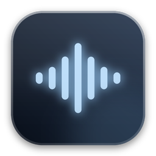
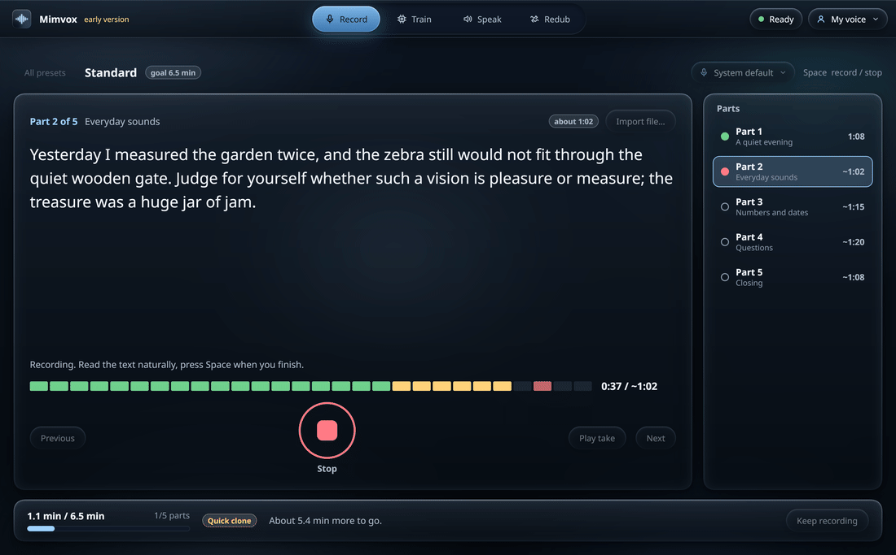
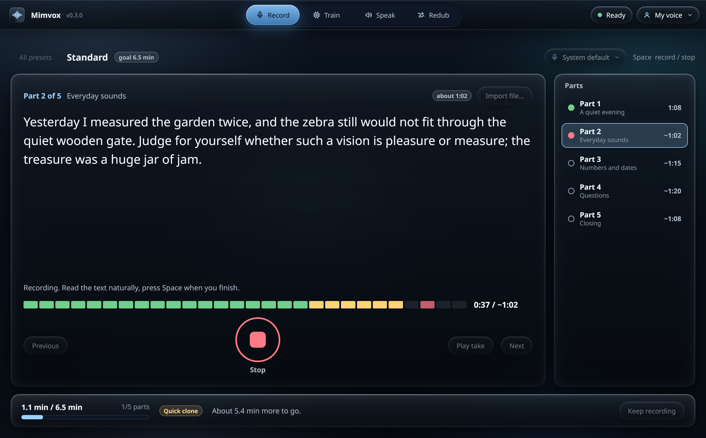
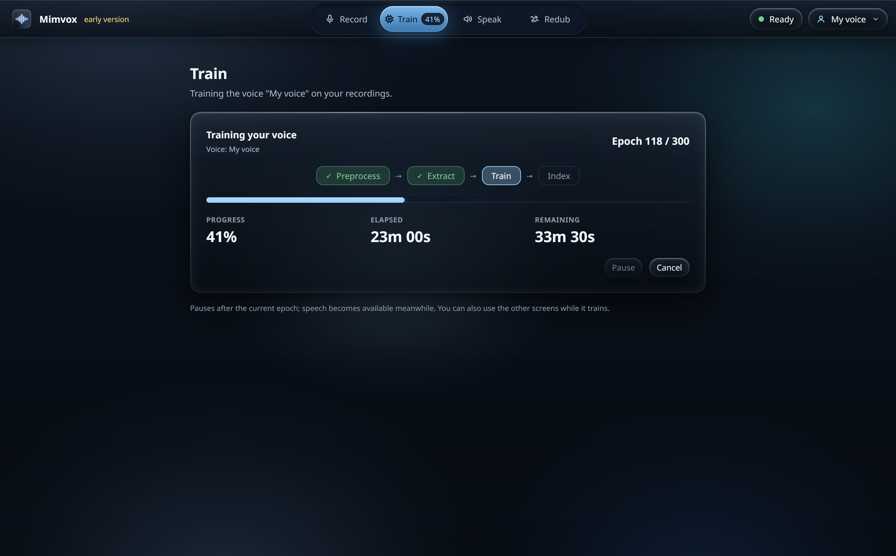
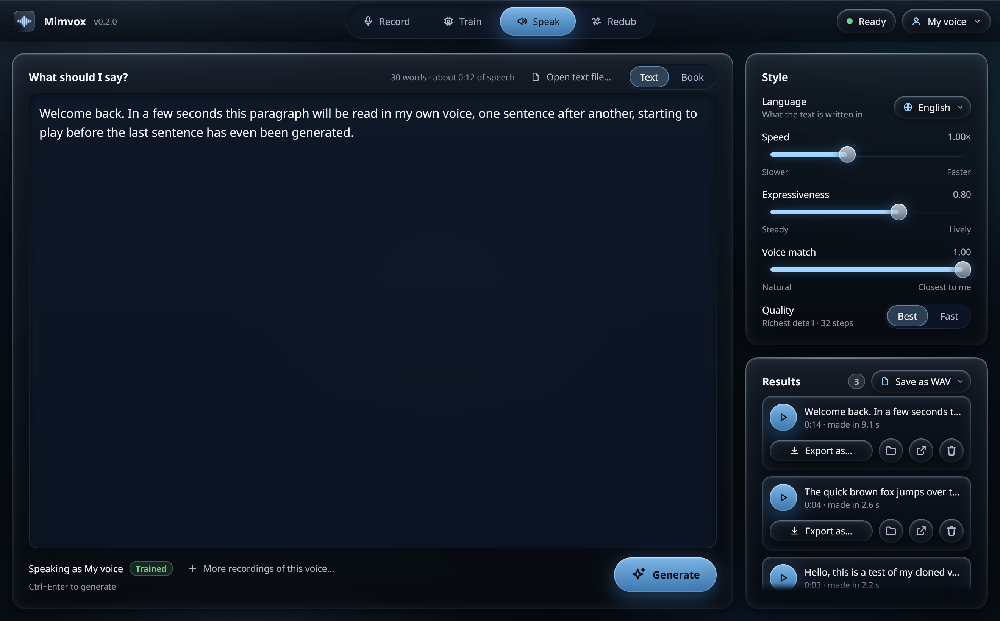
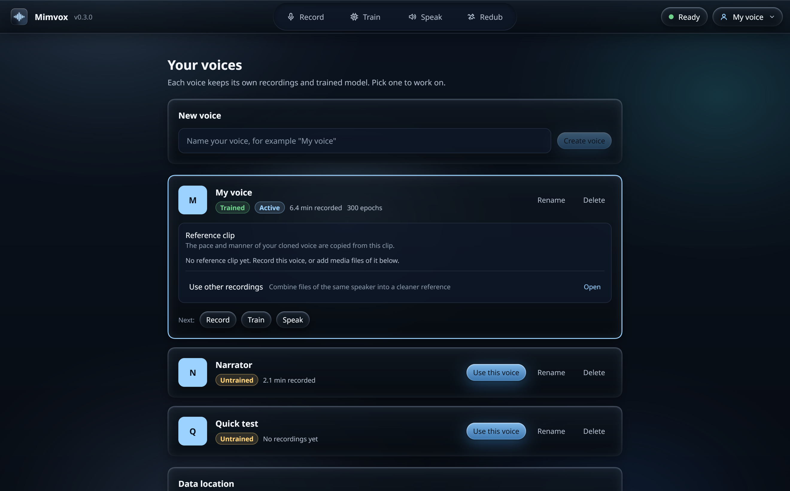

<div align="center">
  
  <h1>Mimvox</h1>
  <p><strong>Clone your own voice on your own computer, then type text in English, Ukrainian or about 60 other languages and hear it in your voice.</strong></p>
</div>

Mimvox is a desktop app. You read a short guided text into your microphone, the app trains a voice model
from that recording, and from then on you type any text (English, Ukrainian and about 60 more languages) and hear it
spoken in your own voice. Everything runs
on your computer: your recordings, your voice models and the generated speech are never uploaded anywhere.

<p align="center">
  
</p>

> [!WARNING]
> **Early version: expect bugs.** This is a hobby project in active development. Features may not work, may work
> badly, or may change between versions, and setup may fail on systems it was not tried on. Keep your own copies of
> recordings that matter. Bug reports are welcome: open an issue.

## Consent and legal: read this first

> **Clone only your own voice, or a voice whose owner has given you explicit permission.** Voice cloning can be used
> to deceive people. This project exists so that you can have a synthetic copy of *your own* voice. It must never be
> used to imitate someone else without their permission.

- **Your own voice, or explicit permission.** Record only yourself, or a person who has clearly agreed (ideally in
  writing) to being cloned and to how you will use the result. Never use a recording taken from a call, a video, a
  podcast or any other source of someone else's voice.
- **No impersonation, fraud or deception.** Do not use generated speech to pretend to be someone else, to trick
  people (phone scams, fake voice messages, fake endorsements), to harass, defame or mislead anyone, to bypass voice
  identification, or to produce content that is illegal where you or the listener live. If you publish generated
  speech, say that it is synthetic where the law or common decency expects it.
- **Non-commercial use only.** The OmniVoice model weights the app speaks with are licensed
  [CC BY-NC 4.0](THIRD_PARTY_NOTICES.md#omnivoice-code-apache-20-model-weights-cc-by-nc-40) (because of their training
  data), and so is the NLLB-200 translation model used by Redub. This project is therefore for personal,
  non-commercial use.
- **Follow your local law.** Rules on biometric data, voice rights, deepfakes and synthetic media differ by country and
  state. You alone decide how you use the app and you are responsible for complying with them.
- **Not legal advice.** The full text is in [DISCLAIMER.md](DISCLAIMER.md). Third-party licences are listed in
  [THIRD_PARTY_NOTICES.md](THIRD_PARTY_NOTICES.md).

---

## Features

| Feature | Description |
| --- | --- |
| **Guided recording presets** | Pick a preset and read the text on screen: **Quick** (about 1 minute, usable at once with no training), **Standard** (about 6-7 minutes, trains a timbre model, the validated setup) or **Pro** (about 15-20 minutes, best similarity). One part at a time, with big text, one key to start and stop, automatic saving and automatic advance. |
| **Your own text** | Prefer to read something else? Paste your text and the app analyses it: word count, estimated reading time, **phoneme coverage** (which English sounds your text covers and which are missing), and a verdict (too short, zero-shot, trainable, great). It then splits the text into parts of about 60-90 seconds. |
| **Recording quality checks** | Every take is checked right away: duration, peak level, clipping, loudness, noise floor, signal-to-noise ratio and silence. You get a plain verdict (ok, warn, bad) with advice such as "Too quiet: speak closer to the mic", so you re-record before training, not after. |
| **One-click training** | Press **Train**. The app prepares the dataset, extracts features, trains the timbre model, builds its index, shows progress and an estimated time, and can be cancelled. The number of epochs is chosen from the length of your recording. |
| **Fast streaming generation** | Type text in English, Ukrainian or another supported language and press **Speak**. Long text is split into segments and each segment plays as soon as it is ready, while the rest is still being generated. The models stay loaded in a persistent engine, so the second phrase is much faster than the first. |
| **History and export** | Every result is saved as one file in the format you pick (WAV by default, or MP3, FLAC, OGG, Opus, M4A, AIFF). Play it again, or export it to another format. |
| **Several voices** | Keep more than one voice (for example "Studio" and "Casual"), rename or delete them, and see how much data each one has. |
| **Two sliders** | **Expressiveness** and **Voice match**. The validated defaults are already set; you do not need to touch anything else. |
| **Private by design** | No account, no cloud, no telemetry. Setup downloads the models once; after that the app works offline. |

---

## How it works

```
 your recording ──► reference clip (15-30 s) ──┐
                                               ▼
 typed text ──► OmniVoice (zero-shot TTS, ~60 languages, speaks like you from the reference clip)
                                               │  24 kHz speech
                                               ▼
                    RVC timbre model trained on your recording (Applio)
                                               │  40 kHz, resampled to 44.1 kHz
                                               ▼
                                     speech in your voice
```

1. **OmniVoice** ([k2-fsa](https://github.com/k2-fsa/OmniVoice)) is a zero-shot text-to-speech model. From a short
   reference clip of you it speaks any text, in about 60 languages, in a similar voice. That alone is the *Quick*
   preset: no training at all. It replaced IndexTTS-2.5 (English and four more languages only): on the same English
   text and voice it was as clear, closer to the speaker and about four times faster with less than half the memory.
2. **RVC** (Retrieval-based Voice Conversion, trained with [Applio](https://github.com/IAHispano/Applio)) is then
   trained on your longer recording. It converts the zero-shot speech so its timbre is closer to yours. Measured with a
   speaker-similarity score (ECAPA), RVC lifts an English paragraph from about 0.81 to about 0.94, where 0.93 is the
   score of your own real recordings against each other. For other languages than the one you recorded in, the RVC
   index is used at a lower rate so the words stay clear. Details: [docs/performance.md](docs/performance.md).
3. **A persistent engine.** The app starts a Python engine once (a child process) and keeps OmniVoice and the RVC
   worker loaded in GPU memory, so the first sound of a phrase comes after about 1-3 s. The app and the engine talk
   JSON lines over stdin/stdout: [contract/engine-protocol.md](contract/engine-protocol.md).
4. **The app** is written in Rust on [Rune](https://github.com/anomalyco/rune), with microphone capture and playback
   through `cpal` and `hound`. The UI never blocks and never polls: engine messages and audio arrive as events.

More: [docs/architecture.md](docs/architecture.md).

---

## Requirements

| | |
| --- | --- |
| **GPU** | **NVIDIA GPU with 8 GB of VRAM or more recommended** (Windows and Linux). It was developed and measured on an RTX 4070 with 12 GB. OmniVoice needs about 4-5 GB of VRAM, and the RVC worker is loaded beside it. |
| **macOS** | Best effort: Apple Silicon through MPS. It has not been validated; expect it to be slower. |
| **Disk space** | About **28 GB** for the runtime (engine with OmniVoice ~11 GB, Applio/RVC ~12 GB: two Python environments with their own PyTorch, plus Whisper and the translation model for Redub ~4.5 GB), plus ~0.1 GB per voice. Setup asks where to install (default: the local app data folder), shows the free space and refuses below 32 GB unless `--force`; `setup --move-to <dir>` moves an existing install. An older install's `runtime/index-tts` (IndexTTS, ~19 GB) is no longer used: setup offers to delete it (`--remove-indextts`). |
| **Microphone** | Any decent microphone; a headset or a desk microphone 15-20 cm from your mouth works. See the [recording guide](docs/recording-guide.md). |
| **Network** | Needed once, during setup, to download the toolchains, the runtime and the models (several GB from Hugging Face). |
| **Language** | Speech in English, Ukrainian and about 60 more languages (the language of the text is a setting). You can record in English; for the most natural accent in another language, a short reference clip in that language helps. |

---

## Quick start

```bash
git clone https://github.com/tarpetos/mimvox.git
cd mimvox
./setup.sh          # Linux and macOS
```

```powershell
.\setup.cmd         # Windows
```

Setup installs what is missing (the Rust and Python toolchains), builds the two Python environments (the engine with
OmniVoice, and Applio), downloads the models and writes `runtime.toml`. It can be run again at
any time; it skips what is already done. Then start the app:

```bash
cd app
cargo run --release
```

On first start the welcome screen checks that setup has run. Then choose a
preset (or paste your own text), record, press **Train**, and start typing.

## Usage

The [usage guide](docs/usage.md) walks through the whole app step by step: setup and the data folder, recording
(presets, your own text, microphone, importing files), voices and reference clips, training with pause and resume,
speaking in other languages, Redub (translate and dub a video, convert, re-speak), tips for quality and
troubleshooting.

## Build

Installers for the desktop app are made by the scripts in `scripts/build/`, one per operating system (the files are
named `build-*.sh` and `build-*.ps1`); the output goes to `dist/`. Read the header of each script for its options.
The packaging configuration is `app/Packager.toml`, the icons are in `tools/release/icons/`.

The models are large and carry their own licences, so they are downloaded by setup on each user's computer
rather than being bundled; see [THIRD_PARTY_NOTICES.md](THIRD_PARTY_NOTICES.md).

---

## Project layout

```
app/                   Rust desktop app (Rune UI, microphone and playback, engine client)
  src/engine/          engine process client and protocol types
  src/audio/           capture and playback (cpal, hound)
  src/ui/              screens: onboarding, record, train, voices, speak
engine/                Python engine (mimvox_engine), runs in the engine virtualenv
  src/mimvox_engine/
    server.py          JSON-lines server
    tts.py, rvc.py     generation pipeline and RVC client (rvc_worker.py runs in the Applio venv)
    backends/          speech model: OmniVoice worker, text normalization (numbers, abbreviations)
    dataset/           recording checks, text analysis, dataset management
    training/          RVC training driver
presets/<lang>/        the guided reading texts (Quick, Standard, Pro) per language: en uk de fr es pl
contract/              engine-protocol.md: the app <-> engine protocol and data layout
tools/setup/           setup.py (called by setup.sh and setup.cmd)
tools/release/         icons and release helpers
scripts/build/         installer builds per operating system
docs/                  architecture, recording guide, performance, screenshots
```

Where your data lives (voices, datasets, trained models, generated audio) is described in
[docs/architecture.md](docs/architecture.md#data-layout).

---

## Screenshots

<!-- The screenshots are produced from the real app by the UI build; see docs/screenshots/. -->

| Record | Train |
| --- | --- |
|  |  |

| Speak | Voices |
| --- | --- |
|  |  |

---

## Troubleshooting

| Problem | What to do |
| --- | --- |
| **Setup fails to clone a repository on Windows with a TLS / certificate error.** The Git that Windows ships in some environments is MinGit, whose default TLS backend cannot verify some certificates. | Run Git with the Windows certificate store: `git -c http.sslBackend=schannel clone ...`, or set it once with `git config --global http.sslBackend schannel`. Then run `setup.cmd` again. |
| **A model download stops with a timeout or a Hugging Face connection error.** The model files are large (several GB). | Run setup again: downloads resume and finished files are skipped. If your connection to huggingface.co is slow or filtered, set `HF_ENDPOINT` to a mirror, or `HF_HUB_DOWNLOAD_TIMEOUT=120` for a longer timeout, and retry. |
| **"CUDA out of memory", or generation suddenly gets very slow.** OmniVoice and the RVC worker share the GPU. | Close other programs that use the GPU (games, browsers with hardware acceleration, other models). 8 GB is the practical minimum; 12 GB is comfortable. Do not train while generating. If it keeps happening, restart the app: the engine reloads cleanly. |
| **The first phrase takes a long time.** | The first phrase loads the models (RVC alone takes about 16 s cold against 1.7 s warm). Later phrases are much faster. Leave the app open: the models stay loaded. |
| **My recording is "too quiet".** | Move the microphone to 15-20 cm from your mouth, raise the input level in your system's sound settings, and record again. Avoid laptop microphones far from you. |
| **My recording is "clipping" or "too loud".** | Move the microphone further away, lower the input level, and do not speak straight into it (use it slightly to the side to avoid plosives). Re-record that part. |
| **The voice has a foreign accent in another language.** | OmniVoice carries the accent of the reference clip into the target language: an English reference gives Ukrainian with a slight English colour. Put a 7-12 s clip of you speaking that language as `reference_<lang>.wav` (for example `reference_uk.wav`) in the voice's folder; it is used for that language. |
| **The voice sounds like gibberish or the wrong language.** | Check that the language setting matches the text. In a language you did not record in, keep *Voice match* moderate: a high RVC index pulls the sounds towards your recorded language (the engine already caps it at 0.3 there). |
| **Some tiny slices warn that the pitch extractor (rmvpe) fell back to CPU during training.** | Harmless. A few very short slices cannot run on the GPU and are processed on the CPU instead. |
| **MP3 export sounds wrong or fails.** | RVC produces 40 kHz audio, which MP3 cannot store. The app resamples to 44.1 kHz first; if you export yourself, do the same. |
| **The result does not sound enough like me.** | Use the **Standard** or **Pro** preset (the Quick preset is zero-shot only), keep the room and the microphone the same for all parts, and raise *Voice match*. See the [recording guide](docs/recording-guide.md). |

---

## Documentation

| Page | What it covers |
| --- | --- |
| [Architecture](docs/architecture.md) | App, engine and RVC worker, data layout, protocol summary |
| [Recording guide](docs/recording-guide.md) | Microphone, room, distance, levels, presets, how much data you need |
| [Performance](docs/performance.md) | Measured speed, training time and similarity scores |
| [Engine protocol](contract/engine-protocol.md) | The app <-> engine protocol |
| [DISCLAIMER.md](DISCLAIMER.md) | Consent and responsibility |
| [THIRD_PARTY_NOTICES.md](THIRD_PARTY_NOTICES.md) | Licences of the software and models used |
| [CHANGELOG.md](CHANGELOG.md) | What changed |

## License

Copyright 2026 [tarpetos](https://github.com/tarpetos). All rights reserved except as granted by the license.

The source code is available under the [PolyForm Noncommercial License 1.0.0](LICENSE): you may use, change and share it
for any **non-commercial** purpose (personal use, study, research, hobby projects, and use by charities, schools and
public institutions). **Commercial use needs a separate license** from the author: open an issue to ask. Contributions
are accepted under the terms in [CONTRIBUTING.md](CONTRIBUTING.md).

Third-party components and the models setup downloads keep their own licences: see
[THIRD_PARTY_NOTICES.md](THIRD_PARTY_NOTICES.md). Responsible use: [DISCLAIMER.md](DISCLAIMER.md). Questions and bug
reports: open an issue on the project's GitHub page.
