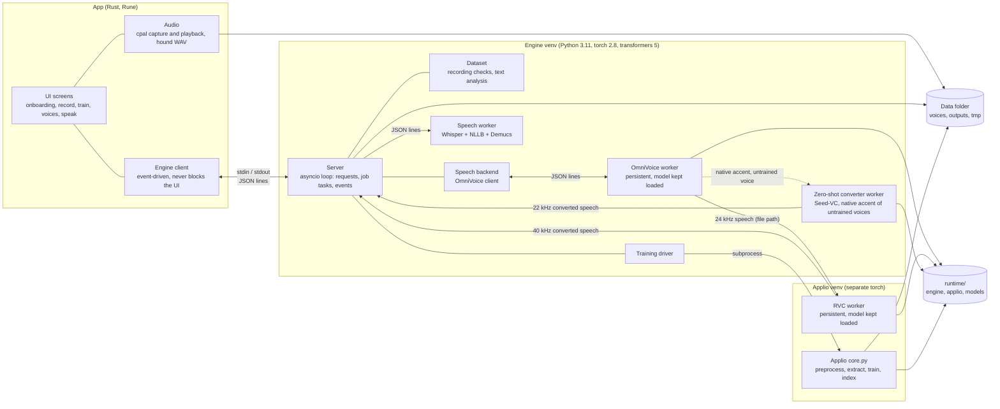

# Architecture

Mimvox has these runtime parts: the **app** (Rust), the **engine** (Python, a child process of the app), the
**OmniVoice worker** (the speech model, a child process of the engine with the engine's interpreter), the **RVC worker**
(a child process of the engine in a second virtual environment) and the **speech worker** (Whisper + NLLB for Redub and
Hybrid Demucs for removing background music from media files, a child process of the engine with the engine's
interpreter) and the **zero-shot converter worker** (Seed-VC, the native accent of untrained voices, with the engine's
interpreter, started on first use; Seed-VC itself is fetched by setup into `runtime/seed-vc`). RVC **training** is run by the engine
as a job in the second environment (Applio's CLI).

## Overview



### Why these processes

- **Two Python environments.** The engine environment (OmniVoice, Whisper, NLLB) runs Python 3.11 with torch 2.8 and
  transformers 5; Applio runs Python 3.12 with torch 2.11. They cannot share one environment, so RVC lives in its own,
  behind a worker process.
- **Models in worker processes.** OmniVoice, RVC and Whisper/NLLB/Demucs each run in a persistent worker: a native crash cannot
  take the engine down, and handing the GPU to a training is ending the processes (all their VRAM and host RAM back at
  once).
- **A persistent engine.** Loading the models is the slow part. The engine starts once with the app and keeps OmniVoice
  and the RVC worker loaded in GPU memory, so each phrase pays only for synthesis (see
  [performance.md](performance.md)).
- **The app never blocks and never polls.** A reader thread hands every engine line to the UI thread as an event
  (Rune's `AppHandle::update_if` wakes the event loop); audio callbacks, file dialogs and subprocess readers do the
  same, and the few clocks (toast expiry, a running job's elapsed time) are timer deadlines (`Tx::wake_at`). An idle
  window draws nothing and wakes for nothing (`app/src/ui/events.rs`).

## Engine internals (event-driven)

The engine never polls: no `while True`, no sleep loops, no "check every N ms". Everything is driven by events on
**one asyncio event loop** (`server.py`, helpers in `aio.py`).

| Piece | How it works |
| --- | --- |
| Requests | The protocol pipe is read line by line as lines arrive (Windows: one reader thread that hands each line to the loop with `call_soon_threadsafe`; elsewhere an asyncio pipe reader). Each request is a task. `async def` handlers run on the loop (they own the shared state: job slot, model status, workers, so no locks are needed); plain `def` handlers (dataset, voices) run on the IO pool. |
| Output | Results and events go through one queue drained by a single writer coroutine (order kept; the bytes are written on a dedicated thread so a slow reader never blocks the loop). `ctx.emit` is callable from any thread. |
| Jobs | `ctx.start_job` makes a task; `*.cancel` cancels it. A generation is a producer task (synthesis) and a consumer task (RVC, resample, `tts.chunk`) joined by a bounded queue (`aio.gather_or_cancel`). |
| GPU | One single-thread executor (`aio.GPU`) for in-process model calls (none today: OmniVoice, RVC and Whisper/NLLB run in workers whose request queues serialize their calls). Training's hand-over is two awaited steps: release the speech backend (its worker exits) + stop the other workers (exits awaited), then a background reload when the job ends. The `models` events are unchanged. |
| Workers | `workerproc.WorkerClient`: one owner task per worker consumes a request queue, starts the process when needed (asyncio subprocess streams), writes one request `{"id","op",...}` and awaits its reply. A reader task resolves replies by `id` and turns `progress` lines into callbacks; at EOF it awaits the exit and fails every pending future, and the next request restarts the process. Timeouts are timers on the awaited reply. Worker side (`worker_kit.py`): stdin reader thread -> loop -> one op thread; idle unload / exit are `call_later` timers. |
| Training | Applio steps are asyncio subprocesses; progress events come from their output lines; cancel = task cancellation + process-tree kill (`taskkill /T` on Windows, the process group elsewhere), awaited; pause = the line watcher stops the tree right after a checkpoint is on disk (or when a `call_later` patience timer fires). |
| Shutdown | `shutdown` / stdin EOF: requests in flight answer, Applio's tree is stopped (the run stays resumable), jobs are cancelled, workers get `quit` and their exits are awaited. |

**Why stdin is detached.** On Windows every anonymous pipe is a synchronous file object, and Windows serializes all I/O
on such an object: while one thread waits in `ReadFile` on the pipe, any other request on that object waits until the
read completes. Loading DLLs (`import torch`) makes such a request on the standard input handle. In the speech worker
the stdin reader thread was always waiting, so `load_asr` (which imports torch) hung until the *next* line arrived;
`redub.prepare` waited for its reply forever and `redub.dub` queued behind it (the deadlock seen with py-spy; reproduced
in isolation: a request that imports torch never finished until a second line was written, with either stdin reader).
The engine and both workers therefore move the protocol pipe to a private descriptor and point fd 0 /
`STD_INPUT_HANDLE` at NUL before any thread reads it. The engine's own model loading had the same latent stall.

## TTS backends (multilingual seam)

The speech pipeline (`tts.generate`, `voices.warm`, Redub respeak and dub) never calls a model directly. Per segment it
picks the backend for the segment's language and awaits one call (`backends/__init__.py`):

```python
class TtsBackend(abc.ABC):
    name: str
    languages: frozenset[str]          # ISO 639-1 codes
    async def synthesize(self, text, lang, reference, params: SynthParams) -> str: ...   # writes a WAV, returns its path
    # optional: status(), load(runtime), release(), count_tokens(text), is_warm(reference), forget_reference()

SynthParams(out_path, temperature=0.8, quality="best", duration_factor=1.0, first=False)
```

- `reference` is the voice's `reference.wav`; the WAV may have any sample rate. RVC, 44.1 kHz resampling, pauses and
  Redub slot fitting happen afterwards, the same for every backend.
- Redub slot fitting (`redub/render.py`): `plan_factor` picks `duration_factor` before synthesis (a clip first uses the
  silence after its slot, then the factor goes down to 0.85, then the stretch is planned, and only then down to 0.8);
  after synthesis `stretch_rate` decides the speed-up (at most 1.15x), done by `media.time_stretch`: one ffmpeg run on
  the IO pool, raw samples through pipes, with the `rubberband` filter when the build has it (e.g. Ubuntu's ffmpeg on
  Linux usually does) and `atempo` (WSOLA) otherwise (the Applio ffmpeg on Windows). Without either the clip overruns.
  librosa's phase vocoder is no longer used: it made dubs sound metallic.
- OmniVoice (`backends/omnivoice.py`, about 60 languages) is the backend; its status is the `tts` entry of the
  `models` event (IndexTTS-2.5, the earlier backend, was removed).
- Another backend is a module in `backends/` with a `TtsBackend` subclass, registered in `backends._builtin()`.
  In-process GPU work goes through `aio.run_gpu`, a model in another process behind a `workerproc.WorkerClient`, CPU
  work through `aio.run_io`;
  never block the loop. `load` is called at start-up and after a training, `release` before a training. The first
  registered backend that speaks a language wins. `tts.generate`'s `language` parameter and Redub's language guard accept
  every language in `backends.languages()`.

## Generation path

1. The app sends `tts.generate` with the voice, the text, its language and the sliders.
2. The engine splits the text into segments (the first sentence alone, then growing groups of sentences) and sends each
   to the OmniVoice worker, which spells out numbers and abbreviations for the language, clones the voice from its
   reference clip and synthesises (32 steps; 16 for the first segment and for *fast*; *Expressiveness* sets the sampling
   temperatures, *Speed* OmniVoice's speed).
3. If the voice has a trained RVC model, the engine sends each segment to the RVC worker, which converts it (rmvpe,
   index rate from *Voice match*, capped at 0.3 for a language the voice was not recorded in, protect 0.33, pitch 0).
   Without a trained model the zero-shot audio is returned as is. With the native accent (`accent: "native-us"`)
   OmniVoice speaks from a shipped native clip instead, and the RVC worker (trained voice) or the zero-shot converter
   worker (untrained voice; Seed-VC, timbre from `reference.wav`) converts each segment (`accent.py`, `zsvc.py`).
4. After each segment, the engine emits `tts.chunk` with the path of the final audio so the app can play it at once;
   at the end it saves the whole phrase as one file in the requested `output_format` (WAV by default; other formats are
   encoded from a 44.1 kHz WAV kept in `tmp/play/` for playback) and emits `tts.done` with both paths.

## Speech model: OmniVoice

**OmniVoice** (k2-fsa, a 0.6B diffusion language model, CC BY-NC weights) speaks every language the app offers: English,
Ukrainian and about 60 more (every language with at least ~100 h of its training data). It replaced IndexTTS-2.5,
which spoke five languages: measured head-to-head on a test voice it was as clear in English, closer to the speaker,
about four times faster and needs less than half the memory ([performance.md](performance.md#multilingual-speech-omnivoice)).

- It runs as a persistent worker with the engine's interpreter (`backends/omnivoice_worker.py`, model in
  `<data>/runtime/models/omnivoice`), driven like the RVC and speech workers (`workerproc.WorkerClient` on the engine
  loop; `worker_kit.py` in the worker: a reader thread hands stdin lines to the loop, ops run on one op thread, idle
  timers via `call_later`). About 4-5 GB of VRAM and 2-6 GB of host RAM; 1-3 s per segment (RTF 0.15-0.3 on an
  RTX 4070).
- The voice comes from `reference.wav` (used whole up to 12 s, else cut to 7-12 s of whole sentences; Whisper finds them
  once and `reference.omnivoice.json` caches the cut and its transcript) or from `reference_<lang>.wav` when the voice
  has one for that language (OmniVoice carries the accent of the reference into the target language).
- Its text front-end (`omnivoice_text.py`) spells out numbers, units and abbreviations (Ukrainian with cases and
  agreement), and passes the user's stress marks (`+` or an acute, in Ukrainian, Russian and Belarusian) as an
  upper-case vowel (`omnivoice_stress.py`; dictionary stress for unmarked Ukrainian words is there but off by default).
- The RVC index rate is capped at 0.3 for languages other than the one the voice was recorded in (`rvc.index_rate_for`):
  the index holds only sounds of the recorded language and garbles others at full rate.
- The seam is `backends/__init__.py` (`TtsBackend`); another model would be one more module registered there.

## Media references and music removal

`voices.reference_from_media` (a job) and `media.combine` (Record's multi-file import, a request) share one per-file
pipeline in `dataset/media_ref.py`: decode to mono 44.1 kHz on the IO pool, optionally keep only the **vocals**, then
trim, shorten pauses and normalise on the IO pool. The vocals come from the speech worker's `separate_vocals` op:
torchaudio's Hybrid Demucs (`hdemucs_high`, the `HDEMUCS_HIGH_MUSDB_PLUS` weights that setup puts in
`runtime/models/demucs`; the engine never downloads them). The decoded file goes to the worker as an `.npy` under
`<data>/tmp`, the worker runs the model over 10 s segments that overlap by 25 % and are cross-faded (memory does not
grow with the length; cancel is checked per segment; progress per segment), and writes the vocals back as an `.npy`.

- `remove_music` decides per file: `true` (every file), `false`, or `"auto"` (a video file whose SNR is under 35 dB,
  when the engine runs on CUDA and no training holds the GPU). The app sends the Voices checkbox (remembered in
  `settings.json`, ticked by default on CUDA); Record sends the remembered choice or nothing.
- It never fails a job: without the weights, or when the worker fails, the files are used as decoded, and the done event
  says why (`music_removed`, `music_reason`).
- On the GPU it is fast (45 s of audio in 0.6 s, 0.76 GB peak VRAM on an RTX 4070), so it fits next to OmniVoice and
  RVC; with less than 1.2 GB free it runs on the CPU. `release_gpu` drops it like Whisper and NLLB.

## Training path

1. `train.start` picks the voice's dataset (`dataset/part<N>.wav`).
2. The training driver runs the Applio steps in the Applio environment: **preprocess** (slice and normalise at 40 kHz),
   **extract** (rmvpe pitch and ContentVec features), **train** (HiFi-GAN vocoder, pretrained start, batch 8, epochs
   chosen from the dataset length) and **index** (faiss retrieval index).
3. Progress is reported with `train.progress` events (stage, epoch, percent, estimated time); `train.done` carries the
   result. The model is saved as `rvc/model.pth` and `rvc/model.index` in the voice's folder.
4. Training and generation both need the GPU: do not run them together on a small card.

## Data layout

The engine owns the data folder; the app reads only the files the engine names. Source of truth:
[contract/engine-protocol.md](../contract/engine-protocol.md#data-directory-layout-owned-by-the-engine-the-app-only-reads-files-the-engine-names).

```
<data>/voices/<voice_id>/voice.json          id, name, created, preset, language, reference
<data>/voices/<voice_id>/reference.wav       best 15-30 s clip (or 8-12 s from media), the voice the speech model clones
<data>/voices/<voice_id>/reference_<lang>.wav optional per-language reference clip
<data>/voices/<voice_id>/reference_media.wav  optional media pool: many media files combined (voices.reference_from_media)
<data>/voices/<voice_id>/dataset/part<N>.wav recorded parts (N from 1)
<data>/voices/<voice_id>/rvc/model.pth       trained RVC model (after training)
<data>/voices/<voice_id>/rvc/model.index
<data>/outputs/<timestamp>.<ext>             generated speech and redubs, one file each in the chosen format
<data>/tmp/                                  scratch (incl. tmp/play: playback WAVs of non-WAV results, tmp/separate-<job>:
                                             the file being separated), safe to delete
```

The runtime (the two Python environments, the Applio checkout, the models) is created by setup under `runtime/` and
described by `runtime.toml`:

```toml
[python]
engine = ".../runtime/engine/.venv/bin/python"      # runs the engine, the OmniVoice worker and the speech worker
rvc    = ".../runtime/applio/.venv/bin/python"      # runs the RVC worker and training

[paths]
applio          = ".../runtime/applio"
omnivoice_model = ".../runtime/models/omnivoice"

[device]
backend = "cuda"   # cuda | mps | cpu
```

## Protocol summary

The app starts the engine with `<python> -m mimvox_engine serve --runtime <runtime.toml> --data-dir <data>` and
talks to it over stdin/stdout, **one JSON object per line**. Logs go to stderr. Audio is never sent inline: both sides
exchange absolute file paths.

| Kind | Shape |
| --- | --- |
| Request | `{"id","method","params"}` |
| Success | `{"id","result"}` |
| Failure | `{"id","error":{"code","message"}}`, codes: `bad_request`, `not_found`, `busy`, `not_ready`, `paused`, `cancelled`, `internal` |
| Event | `{"event","job","data"}` |

| Area | Methods and events |
| --- | --- |
| Engine | `hello`, `shutdown` |
| Voices | `voices.list`, `voices.create`, `voices.rename`, `voices.delete` |
| Presets and text | `presets.list`, `text.analyze` |
| Recording and dataset | `recording.check`, `dataset.add`, `dataset.remove`, `dataset.summary` |
| Training | `train.start`, `train.cancel`; events `train.progress`, `train.done`, `train.error` |
| Generation | `tts.generate`, `tts.cancel`; events `tts.chunk`, `tts.done`, `tts.error` |
| Media references | `voices.reference_from_media` (`remove_music`), `voices.media_cancel`, `voices.clear_media`, `media.combine`; events `voices.media.progress` (stages `decode`, `separate`, `combine`, `analyse`, `apply`), `voices.media.done`, `voices.media.error` |

The full parameters and results are in [contract/engine-protocol.md](../contract/engine-protocol.md). That file is the
single source of truth: change it first, then the Rust and the Python side.

## Setup and build

- `setup.sh` / `setup.cmd` call `tools/setup/setup.py`, which installs the toolchains, builds both environments,
  downloads the models and writes `runtime.toml` (an old `runtime/index-tts` is deleted only on confirmation).
- `scripts/build/` makes the desktop installers. They contain the app and the engine source; the runtime and the models
  are created by setup on the target computer.
