# Using Mimvox

This guide walks you through the app from installation to your first dubbed video. It describes what you see on screen
and what happens behind it, with concrete examples. For the background (how the parts fit together, measured speed)
see [architecture.md](architecture.md) and [performance.md](performance.md); for microphone and room advice see the
[recording guide](recording-guide.md).

> **Consent first.** Clone only your own voice, or the voice of a person who has given you explicit permission. The model
> weights are licensed for non-commercial use only. Read [DISCLAIMER.md](../DISCLAIMER.md) before you record anything.

## Contents

1. [Install and first start](#1-install-and-first-start)
2. [The window at a glance](#2-the-window-at-a-glance)
3. [Record](#3-record)
4. [Voices](#4-voices)
5. [Train](#5-train)
6. [Speak](#6-speak)
7. [Redub](#7-redub)
8. [Tips for quality](#8-tips-for-quality)
9. [Troubleshooting](#9-troubleshooting)
10. [Your data folder](#10-your-data-folder)
11. [Consent and licences](#11-consent-and-licences)

---

## 1. Install and first start

### What you need

- An **NVIDIA GPU with 8 GB of video memory or more** is recommended (Windows or Linux). Apple Silicon works on a
  best-effort basis through MPS. Without a supported GPU the app still runs on the CPU, but training a voice takes many
  hours and speech is generated several times slower than real time. Intel Macs are not supported.
- About **32 GB of free disk space** on the drive you install to (the runtime itself is about 30 GB).
- A microphone, and an internet connection for the one-time setup. After setup the app works offline.

### Install the app

Download the installer for your system from the [latest release](https://github.com/tarpetos/mimvox/releases/latest):

| System | File | How to install |
| --- | --- | --- |
| Windows (x64) | `mimvox_<version>_x64-setup.exe` | Run it. No administrator rights needed. |
| Windows (ARM) | `mimvox_<version>_arm64-setup.exe` | Run it. |
| macOS (Apple Silicon) | `Mimvox_<version>_aarch64.dmg` | Open it and drag **Mimvox** into **Applications**. |
| Linux (any distribution) | `mimvox_<version>_x86_64.AppImage` (`aarch64` on ARM) | Make it executable (`chmod +x`), then run it. |
| Debian, Ubuntu | `mimvox_<version>_amd64.deb` (`arm64` on ARM) | `sudo apt install ./mimvox_<version>_amd64.deb` |

The installers are not signed with a paid certificate yet, so the system warns the first time:

- **Windows:** "Windows protected your PC": press **More info**, then **Run anyway**.
- **macOS:** "Mimvox cannot be opened": right-click the app in Applications, choose **Open**, then **Open** again. If
  macOS still refuses, run `xattr -dr com.apple.quarantine /Applications/Mimvox.app` once.

On Windows, the folder page also has **Create a desktop shortcut** and **Add to the Start menu** (both ticked).

**Uninstalling on Windows** (Settings > Apps, or the Start menu entry) asks what to remove:

| Choice | What goes | What stays |
| --- | --- | --- |
| **Only the app** (default) | the app | the speech engine, your voices, results and settings: installing again continues where you left off |
| **The app, the speech engine and its models** | the app, `runtime/`, `cache/`, `tmp/` | your voices, recordings, results and settings |
| **Everything** | all of the above, plus your voices, recordings, trained models, results, audiobooks and settings | anything else you keep in that folder |

It removes only what Mimvox made in the data folder. A scripted `unins000.exe /VERYSILENT` keeps all data;
`/REMOVE=0`, `1` or `2` picks a choice without the window.

### First launch: setup in the app

The installer holds only the app (about 15-30 MB). The speech engine and its models (about 33 GB) are installed by
the app itself on the first start, in its window; there is no script to run and no terminal.

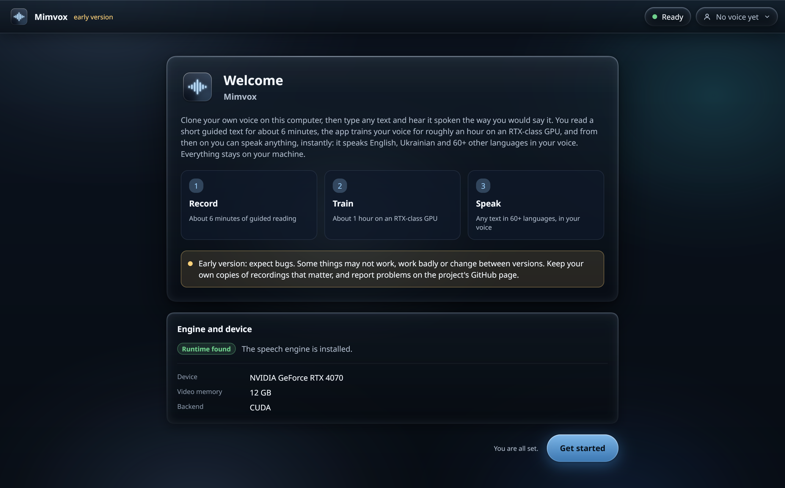

1. **Engine and device** says *Runtime missing*.
2. **What to install.** Choose the parts you want; everything is ticked at first, **Only what is required** keeps
   just Speech (about 13 GB), **Everything** ticks all again:

   | Part | Size (about) | Gives you |
   | --- | --- | --- |
   | **Speech** (always) | 12.6 GB | Speak and Book in about 60 languages, Redub's Re-speak (engine, OmniVoice, Whisper) |
   | Voice training | 12 GB | Train; voice match for trained voices; Redub's Convert voice (Applio/RVC) |
   | Translation | 2.5 GB | Redub's Translate & dub (NLLB-200 600M) |
   | Better translation | 2.7 GB | fewer mistranslations (NLLB-200 1.3B); installed only with an NVIDIA or AMD GPU |
   | Native accent | 2 GB | English with a native accent for voices that are not trained (Seed-VC) |
   | Music removal | 0.3 GB | Redub keeps a video's background music; clean references from videos (Hybrid Demucs) |

   A part left out can be added later in one click: Train shows **Install** when voice training is missing, Redub
   under **Mode** for Translate & dub and Convert voice, and the same small **Install** appears next to Native accent,
   Voice match, "Keep background music" and "Remove background music". It installs in the background with its
   progress on that screen, and the engine restarts by itself when it is done.
3. **Install location** is where everything goes (the data folder). The default:

   | System | Default data folder |
   | --- | --- |
   | Windows | `%LOCALAPPDATA%\mimvox` |
   | macOS | `~/Library/Application Support/mimvox` |
   | Linux | `~/.local/share/mimvox` (or `$XDG_DATA_HOME/mimvox`) |

   Edit the path or press **Change location…** to install on another drive; the free space there is shown below the
   field; it turns yellow when the drive has less room than the chosen parts need.
4. Press **Run setup**. The card shows the steps with a progress bar and what setup is doing right now; **Show
   details** opens its log. The GPU is found by itself (NVIDIA: CUDA; AMD on Linux: ROCm; Apple Silicon: MPS;
   otherwise the CPU).
5. When setup is done the engine starts by itself: the status pill at the top right says *Starting engine…*, then
   *Loading models…*, then **Ready**, and the card shows your device. Press **Get started**.

**Cancel** stops setup; **Run setup again** continues where it stopped (every step skips what is already there and an
interrupted download resumes), so a lost connection costs nothing. Closing the app stops a running setup the same
way. Setup asks for no administrator rights: where git or ffmpeg are missing it downloads what it needs itself.

On a computer without a GPU the card says that training would take many hours, while a quick (zero-shot) voice still
works.

### From the source code (developers)

Working on Mimvox itself, set up the repository with the setup script instead: it also installs the toolchains the
app is built with (Rust, a C/C++ compiler, the system packages on Linux) and asks where to put the data folder.

```bash
./setup.sh          # Linux and macOS
.\setup.cmd         # Windows
cd app && cargo run --release
```

The script installs `uv` if it is missing, then runs `tools/setup/setup.py` (the same program the app runs). Useful
options (all of them: `./setup.sh --help`):

| Option | What it does |
| --- | --- |
| `--data-dir DIR` | Install into `DIR` without asking. |
| `--yes` | Do not ask for confirmation (then `--data-dir` is required). |
| `--cpu` | Set up the CPU backend even when a GPU is present. |
| `--quick-check` | Verify an existing install, download nothing. |
| `--move-to DIR` | Move an existing install to `DIR` (see below). |
| `--better-translation no` | Leave out the better translation model (NLLB-200 1.3B); `yes` adds it also without a GPU. |
| `--components LIST` | Install exactly these parts (`speech,training,translation,better_translation,native_accent,music_removal`); later runs keep the same set. |
| `--add LIST` | Add parts to an existing install. |
| `--skip-toolchain` | Install no toolchains or system packages (the app's own setup runs this way, with `--gui`). |

### Moving the data folder later

To move everything (runtime, models and your voices) to another drive:

1. Open **Voices** (the voice menu at the top right, then **Manage voices**).
2. At the bottom, under **Data location**, press **Move data…** and pick an empty folder.
3. The app shows how much it will move and the free space on the new drive, then asks you to confirm. The voice engine
   stops while the files are copied and starts again afterwards. Nothing is deleted from the old folder until the copy
   is complete and checked; if the move fails, your data stays where it was and keeps working.

In a repository checkout the same can be done from a terminal while the app is closed: `./setup.sh --move-to <new
folder>` (or `setup.cmd --move-to <new folder>` on Windows). An interrupted move resumes when you run the same command again. A data folder
fixed by the `MIMVOX_DATA` environment variable cannot be moved from the app.

---

### Updates

An installed app checks once per launch whether a newer version exists. If one does, a banner under the header says
so: **What's new** opens the release page, **Skip this version** hides it for good, **Later** until the next launch,
and **Update** downloads it in the background. The download is checked against the project's signature before it is
kept; then **Restart now** installs it and starts the new version (a running training or book pauses and continues
afterwards), or it installs by itself when you close the app.

| Installed from | How it updates |
| --- | --- |
| Windows setup `.exe` | the installer runs with only a progress bar, then the app starts again |
| Linux AppImage | the new AppImage replaces the file you started (a name with the old version, as downloaded, gets the new version) |
| macOS `.dmg` | the new Mimvox.app replaces the one in Applications |
| Linux `.deb` | **Download** opens the release page; install the new `.deb` as before |

Your voices, results and the engine runtime are not touched by an update. When a new version needs newer engine
packages or models, a second banner says **This version needs a setup update**: **Run setup** runs setup again into
the same data folder, which installs only what changed, and the engine restarts by itself when it is done. To turn the check off, set
`"check_updates": false` in `settings.json` in your data folder.

## 2. The window at a glance

- **Tabs** in the middle of the header: **Record**, **Train**, **Speak**, **Redub**.
- **Engine pill** on the right: *Ready*, *Loading models…*, *Training · speech paused*, *Models missing* or
  *Engine stopped*. When the engine has stopped, press it to restart.
- **Voice pill** at the far right: the active voice. Open it to switch voices, see whether each one is *Trained* or
  *Zero-shot*, and reach **Manage voices** (the Voices screen) or **New voice**.
- **Dropping files** anywhere on the window works on every screen: on Record they become the current part's take, on
  Voices they build a reference from media, and elsewhere a single file opens in Redub (see the sections below).
- **The player bar** appears at the bottom of the window whenever something plays (see below).

### The player bar

Everything the app plays goes through one player: a result on Speak or Redub, Speak's live playback, Redub's
**Original** and **Result**, a reference clip or a candidate in Voices, a recorded take on Record. Only one thing plays
at a time; starting another stops the first. While something is loaded, a compact glass bar is docked along the bottom
of the window. It takes its own strip (the screen above it gets a little shorter), so it never covers a screen's
buttons, and messages pop up just above it.

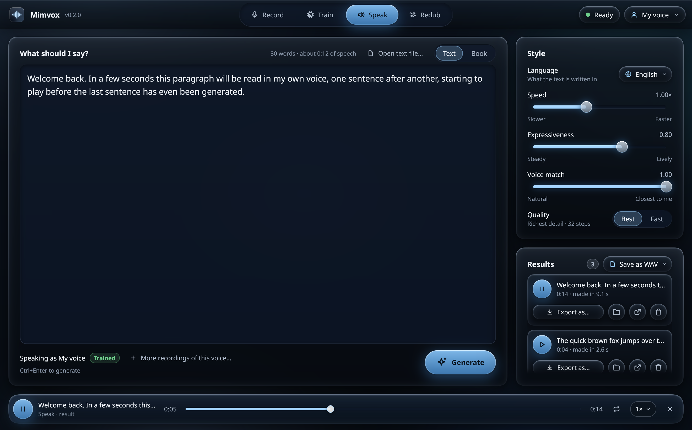

- **Play / Pause**, and **Stop**, which halts the track and rewinds it to the start (the bar stays; Play starts it again). The **×** at the right end ends playback and hides the bar.
- The **title** of what plays (the start of the text, the file name, the clip) and where it comes from
  (*Speak · result*, *Redub · original*, *Voices · My voice*, *Record*).
- The **time** played and the total, with a **seek bar**: click or drag anywhere on it to jump. With the seek bar
  focused, the Left and Right arrow keys jump 5 seconds.
- **Loop** (the two arrows): when on, the track starts again from the beginning when it ends.
- **Speed**: 0.5×, 0.75×, 1×, 1.25×, 1.5× or 2×. The pitch stays the same, so the voice sounds like itself, only
  slower or faster (the app time-stretches the sound while it plays; switching speed takes effect at once, without
  restarting). Loop and speed stay as you set them for the next things you play, until the app is closed.
- **Space** plays and pauses while the bar has the keyboard focus (after you clicked one of its buttons). On the Record
  screen Space always starts and stops the recording.

The play buttons on the screens follow the bar: a result's button shows a pause sign while it plays, pressing it pauses
(the bar stays, with its position), and pressing it again continues. When a track has played to its end the bar
stays, so **Play** starts it again; close the bar when you are done.

While Speak is still generating (see [Streaming playback](#streaming-playback)) the bar shows the part that has
arrived so far (the total ends in *…*), and seeking is off until the whole text is ready. When generation finishes, the
bar shows the finished result and seeking works.

---

## 3. Record

Recording goes into the **active voice**. If you have none yet, the app creates one named "My voice" and selects it.

### Pick a preset and a reading language

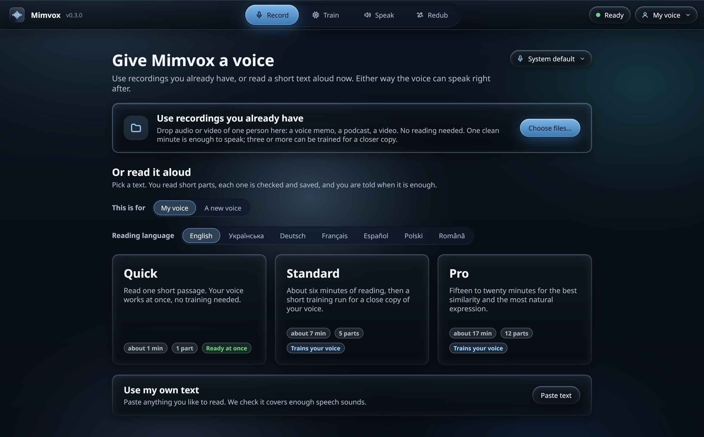

At the top, choose the **Reading language**: English, Ukrainian, German, French, Spanish or Polish. Each language has
its own texts, written for that language, in `presets/<lang>/` (`quick.md`, `standard.md`, `pro.md`). Then pick a
preset:

| Preset | Reading | Parts | What you get |
| --- | --- | --- | --- |
| **Quick** | about 1 minute | 1 | *Ready at once*: no training. Your recording becomes the reference clip and the voice works immediately (zero-shot). |
| **Standard** | about 6-7 minutes | 5 | *Trains your voice*: enough to train a timbre model (RVC) for a close match. The validated setup. |
| **Pro** | about 17 minutes | 13 | *Trains your voice*: more data, the best similarity and the most stable result. |

The voice is created in the language you read. If the active voice already has recordings in another language, the
app keeps it as it is and makes a new voice named, for example, "My voice (Ukrainian)".

**Example: a Standard voice in English.**

1. Open **Record**, set **Reading language** to English and press the **Standard** card.
2. Part 1 of 5 appears in large text. Press **Space** (or the red button) and read it aloud at your normal pace.
3. Press **Space** again when you finish. The take is checked, saved, and the next part opens by itself.
4. Repeat for all five parts. Then press **Ready to train**.

Keys: **Space** starts and stops a recording, **Left** and **Right** move between parts. The **Parts** list on the
right shows which parts are done; you can click any part to go back to it. The bar at the bottom shows the minutes
recorded against the goal. **All presets** goes back to the preset list; **Continue recording** picks up a reading you
started earlier.

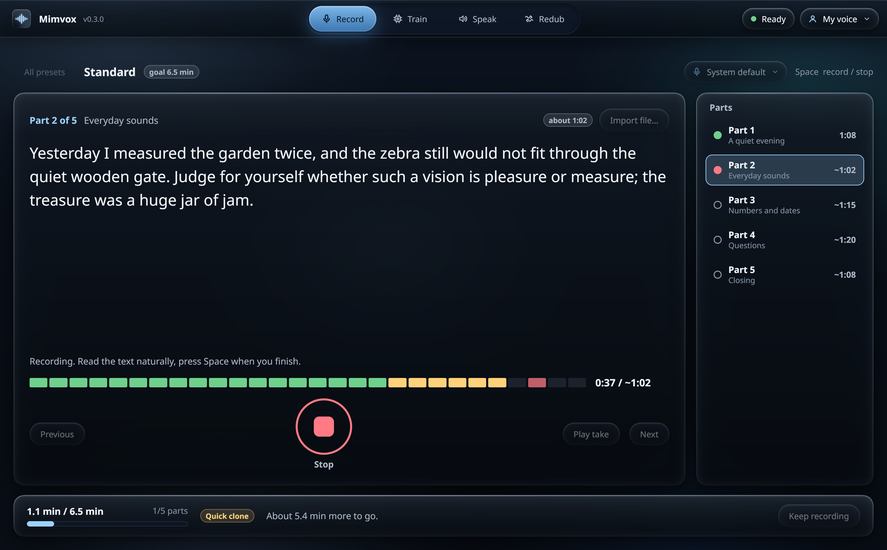

### Your own text, with phoneme analysis

Prefer to read something else? On the preset screen press **Paste text** under *Use my own text*.

1. Paste or type the text (a few minutes of text works best). Set **Language** to **Detect** or pick one.
2. Press **Analyze text**. The app shows the word count, the estimated reading time, the number of parts, the
   language, and a level: *Too short*, *Quick clone*, *Trainable* or *Great*.
3. **Speech sound coverage** is the share of the language's speech sounds (phonemes) your text contains. **Missing
   sounds** lists the ones it lacks, and the message under it gives an example word for each. Add a few sentences with
   those words and analyse again: the more sounds the text covers, the more complete the voice. Coverage below 80%
   lowers the level by one step.
4. Press **Record these N parts**. The text is split into parts of about 60-90 seconds, recorded exactly like a preset.

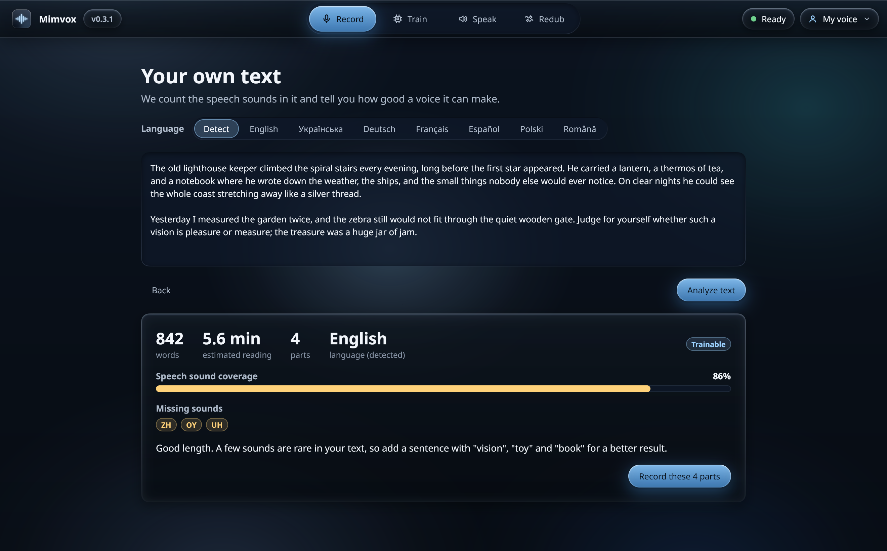

Write one language per text, and write numbers and abbreviations the way they are said.

### Choose the microphone and check the level

The microphone chip next to *Space record / stop* shows the input in use (*System default* until you choose).

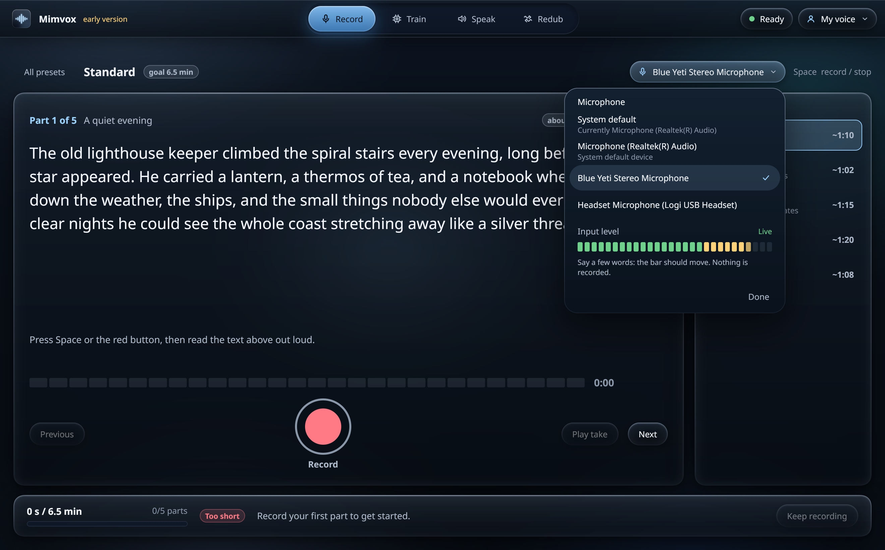

1. Press the chip. The list shows *System default* and every input device the system offers.
2. While the list is open, a live **Input level** test runs on the selected device: say a few words and watch the bar
   move. Nothing is recorded during this test.
3. Pick a device. The choice is remembered. If it is unplugged later, the app falls back to the system default and
   shows a warning such as *"… is not available, using the system default"*.

While you record, a level meter runs under the text. Aim for the bar to move well into the green and yellow during
speech, without touching red. If it says *"Too loud. Move back from the microphone or lower the input volume."*, do
that and record the part again. You cannot switch microphones while a recording runs.

### Quality verdicts and re-recording

Every take is checked as soon as you stop: duration, peak level, clipping, loudness, background noise,
signal-to-noise ratio and silence. You get one of three verdicts:

| Verdict | Meaning | What happens |
| --- | --- | --- |
| **Sounds good** | No problems. | Saved, and the next part opens automatically. |
| **Usable, with notes** | Saved, with advice (for example *"Background noise: a quieter room or a closer microphone would help"*). | Read the notes; press **Continue** to move on, or **Record again** to improve it. |
| **Please record again** | Not usable (too short, too quiet, clipped, mostly silence, too noisy, or no clear speech). | The take is *Not saved*. Press **Record again**. |

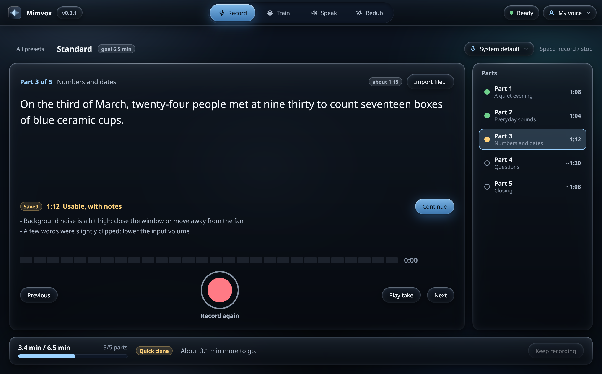

To redo any part, select it in the **Parts** list and press **Record again**. A new take replaces the older one of that
part. **Play take** plays back what you recorded.

### Import a file instead of recording

You can use existing recordings of yourself instead of reading live.

- **Import file…** (top right of the part card) opens a file picker. Choose one file, and it becomes the take of the
  current part. It goes through the same check as a live take.
- **Drag and drop** a file anywhere on the window while a part is open. The part card lights up with *"Release to use
  this file for part N"*.
- **Several files at once** (picked together, or dropped together) are combined into one take. The engine joins them
  (`media.combine`): each file is cleaned (silence trimmed at both ends, long pauses shortened, loudness evened out),
  then they are joined with a short gap, up to 20 minutes in total. You see *"Combining N files into one recording…"*
  and then, for example, *"3 files combined into one recording (4.2 min)."* Files that cannot be read or have no clear
  speech are skipped and named in that message. Background music is removed as you set **Remove background music**
  on the Voices screen (see [Reference from media](#reference-from-media)); if you never touched that box, it is removed
  from video files that have sound under the voice when you have an NVIDIA GPU. The message then adds *"Background
  music removed from N of them."*

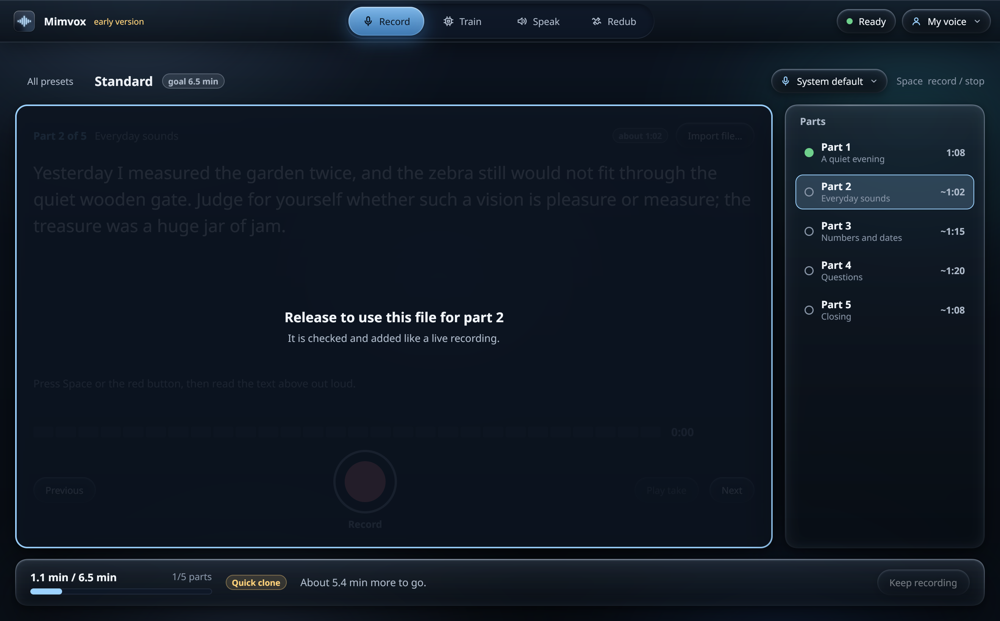

Accepted formats are audio and video: WAV, MP3, M4A, AAC, FLAC, OGG, Opus, AIFF, WMA (when your ffmpeg can decode it),
MP4, MKV, MOV, WebM and AVI. From a video, only the sound is used. Only import recordings of your own voice, or of a
person who has given you permission.

---

## 4. Voices

Open the Voices screen from the voice pill at the top right (**Manage voices**).

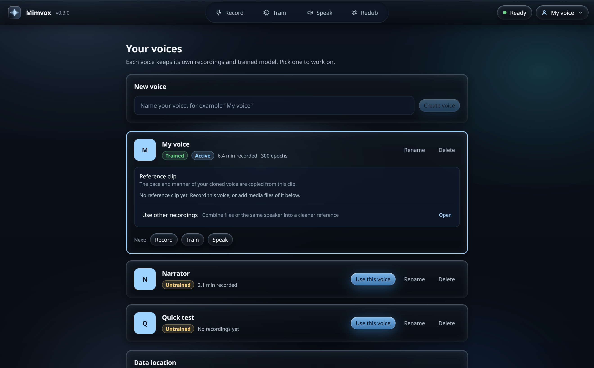

### Create, rename, delete and switch voices

- **Create:** type a name under **New voice** (for example "My voice") and press **Create voice**. A new voice has no
  recordings yet: go to Record next. (Record also creates "My voice" by itself when there is none.)
- **Active voice:** the voice with the *Active* badge is the one Record, Train, Speak and Redub use. Press **Use this
  voice** on another card, or pick it from the voice pill at the top, to switch.
- **Rename:** press **Rename**, edit the name, press **Save**. Only the shown name changes; the voice's folder keeps its
  original id.
- **Delete:** press **Delete**, then confirm *"Delete this voice and its recordings?"*. This removes the voice's whole
  folder (recordings, reference clips and trained model) and cannot be undone. Back it up first if you might want it
  again (see [Your data folder](#10-your-data-folder)).

Each card shows *Trained* or *Untrained*, the minutes recorded, and the number of epochs after training. A paused or
interrupted training shows as *Paused 115/300* or *Interrupted 115/300*.

### The reference clip and "Choose…"

The speech model clones your voice from one short clip of your recordings, the **reference clip**. It copies the pace
and manner of that clip, so a slow or halting clip makes the cloned voice slow. The app picks it automatically from
your best take: a 15-20 second window with a clean signal, a natural pace and few long pauses. (The speech model itself
uses up to 12 seconds of it.)

The active voice's card has a **Reference clip** section showing the clip in use (part, title, and a *Natural pace*,
*Slow* or *Fast* badge) with a play button.

1. Press **Choose…** to see the best candidates from your recordings. The first one is marked *Recommended*.
2. Play a few. Pick one that sounds like your natural, relaxed reading.
3. Press **Use this one**. The next speech uses the new clip. A clip you choose is marked *Chosen by you* and is kept
   until you re-record or remove the part it came from.

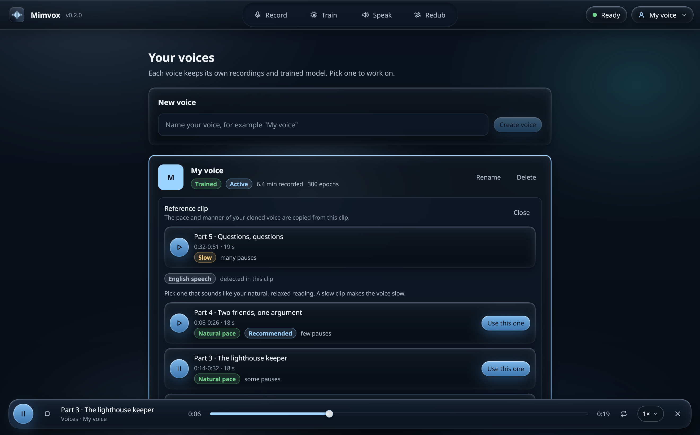

### Reference from media

You can also make the reference from existing audio or video of the same speaker, for example several talks or voice
memos. One noisy source makes a metallic clone, so the app combines many files and picks the cleanest piece.

1. In the **Reference from media** block of the active voice, choose the language the media is in (the chip; by default
   the voice's own language).
2. Leave **Remove background music** ticked if the files have music or effects under the voice (videos usually do).
   The app then keeps only the voice of each file before cleaning it, which makes a cleaner reference: music under the
   reference makes the clone sound metallic. It is a little slower (on an NVIDIA GPU about a second per minute of media;
   on the CPU much longer). The box is ticked by default when the app runs on an NVIDIA GPU, and your choice is
   remembered.
3. Press **Add media…** and pick the files, or drop them on the Voices screen. Many files are fine. (Dropping files on
   Speak, or several files on Train or Redub, also brings you here.)
4. The app cleans each file (*Removing background music* and *Cleaning · File k of n*), combines them, and looks for
   the best window. You can press **Cancel**; a cancelled run changes nothing.
5. When done it reports, for example, *"12 files combined · 7:32 · reference set: 11.4 s from file 3"* and
   *"Background music removed from 9 of 12 files."*, with a play button for the new reference and a list of skipped
   files with the reason. If the music could not be removed it says why, for example *"Background music not removed:
   the music-removal model is not installed (run setup again)."*: the files are then used as they are.

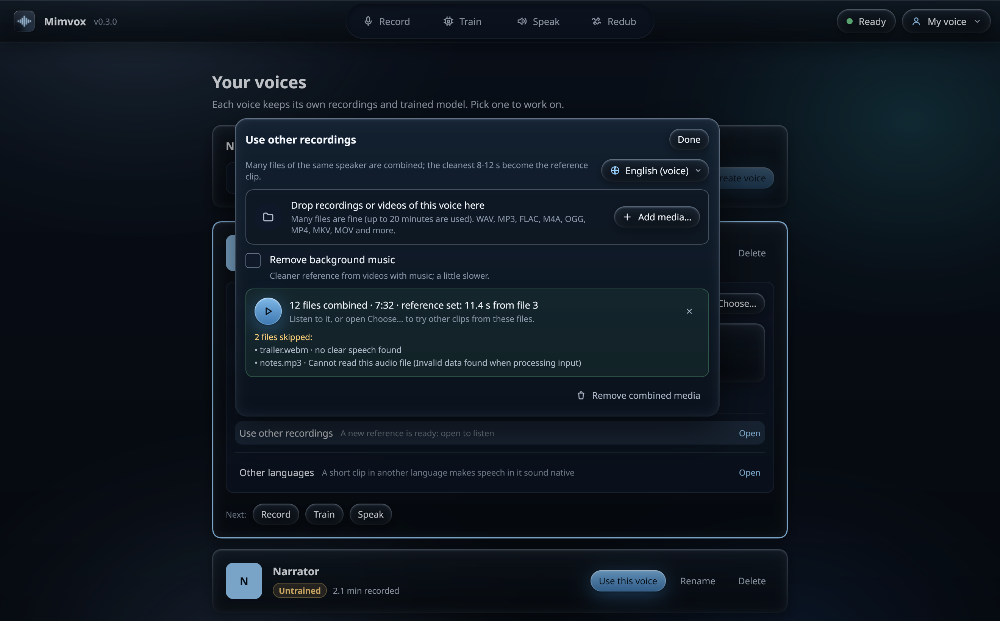

Details:

- Up to 20 minutes of the files are used; later files are listed as not used.
- The pool is cut into windows of **8-12 seconds**, scored by signal-to-noise ratio, pace and pauses. The best one
  becomes the reference. The other good windows appear in the **Choose…** list under *From your media*.
- If you chose the voice's own language, the result replaces the voice's main reference clip. If you chose another
  language, it becomes the per-language clip for that language (see below).
- Your recordings for training are never touched: media files are used only for the reference.
- Music removal works on music and sound effects; it cannot take out a second speaker. Use files where only this
  person speaks.
- **Remove combined media** deletes the combined files; the reference clip in use stays.
- Only use media of your own voice, or of a person who has given you permission.

### Per-language reference clips

A voice speaks every language of the speech model, but with the accent of its reference clip: an English reference
gives Ukrainian with a slight English colour. A short clip of you speaking the other language fixes that.

1. In the **Other languages** part of the reference section, press **Add a language** and pick the language.
2. The app shows a short sample text in that language. Press **Record** and read it at your natural pace (about 10
   seconds), or press **Import file…** to use an existing recording in that language.
3. The take is checked (*Sounds good*, *Usable* or *Not usable*). Press **Use for <language>**.

The clip is used whenever you speak or dub into that language. The voice's card lists the languages that have one;
each can be played or removed. A clip needs 3 to 40 seconds of speech; about 10 seconds is best.

**What your main clip really speaks.** Under the clip in use, the reference section shows the language detected in it,
for example *Ukrainian speech* (the engine transcribes the clip the first time the voice is prepared or speaks; until
then it reads *not checked yet*). This matters more than the language the voice was created with: a voice set to
English whose clip is Ukrainian speech speaks English with a Ukrainian accent. In that case a note says so: *English
will carry this clip's accent. Add an English clip under Other languages, or choose Native accent when it speaks.*

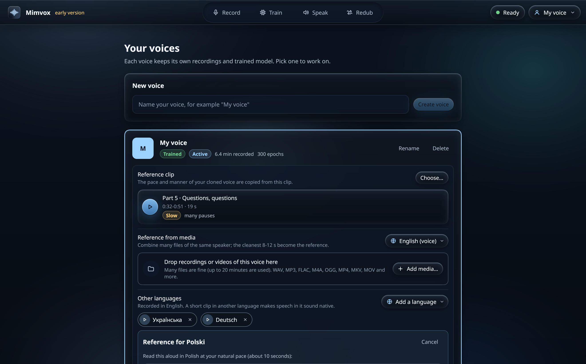

---

## 5. Train

### What training adds

Without training, a voice is **zero-shot**: the speech model imitates you from the reference clip alone. This works at
once (the Quick preset) and sounds similar to you, but not the same. **Training** builds a timbre model (RVC) from all
your recordings. Every phrase is then converted with it, which brings the timbre much closer to your real voice. In
the project's measurements on one speaker, speaker similarity rose from about 0.81 to about 0.94 on an English
paragraph, where 0.93 was the similarity of that speaker's own real recordings to each other
([performance.md](performance.md)).

Training needs at least 3 usable minutes of recordings (the *Trainable* level). With less, the screen offers **Go to
Record**, or **Go to Speak** to use the voice zero-shot.

### Start a training

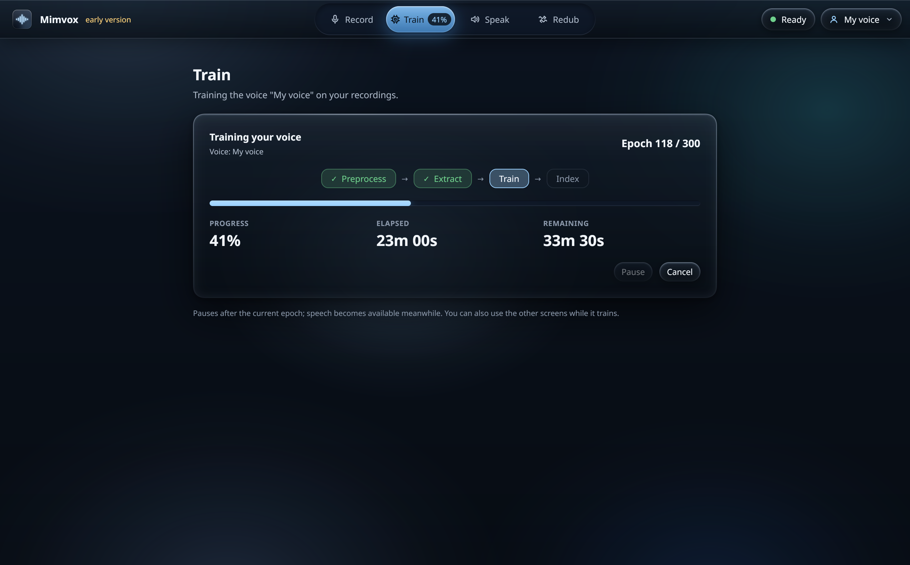

1. Open **Train**. *Your recordings* shows the minutes recorded, the number of parts, the recommended epochs and the
   level.
2. Leave **Epochs** on **Auto** (recommended). Auto picks the number from the length of your recordings: about 300
   for 6-7 minutes, more for less data and fewer for more, between 150 and 450. **Custom** lets you set it yourself.
3. Press **Start training**. The screen shows the stage (*Preparing your recordings*, *Analysing your voice*,
   *Training your voice*, *Building the voice index*), the epoch, the progress, the elapsed time and an estimate of
   the time left.

**How long it takes:** about 55 minutes for 300 epochs on 6.4 minutes of recordings on an RTX 4070 with 12 GB. The Train
screen shows its own estimate before you start. Expect several hours on an Apple GPU and many hours without a GPU.

While a voice trains, the GPU belongs to training: Speak and Redub are unavailable (the engine pill says *Training ·
speech paused*). You can still use the other screens. When training finishes, the speech models reload (about half a
minute) and the voice is marked *Trained*. Press **Go to Speak**.

### Pause and resume

- **Pause** becomes available once the actual learning starts (not during the preparation stages). The app stops at
  the next saved checkpoint, which is written every 5 epochs, so pausing can take up to about a minute. At most a few
  epochs of work are lost.
- While paused, **Speak and Redub work again**. The Train tab and the voice card show *Paused 115/300*.
- Press **Resume** (available once the speech models have loaded again) to continue from the saved epoch.
- **Discard** throws the paused run away. **Cancel** during a training stops it and discards its progress; the voice
  keeps its previous model, if it had one.

### Closing the app during training

If you close the window while a voice trains, the app asks first (*Training is running*):

- **Pause and close:** waits for the next checkpoint, then closes. Resume later from Train.
- **Keep training:** cancels the close.
- **Close anyway:** closes at once. On the next start the run shows as *Interrupted* and can be resumed from the last
  checkpoint (if learning had not started yet, there is no checkpoint and the run starts over).

The same recovery applies after a crash or a power cut.

---

## 6. Speak

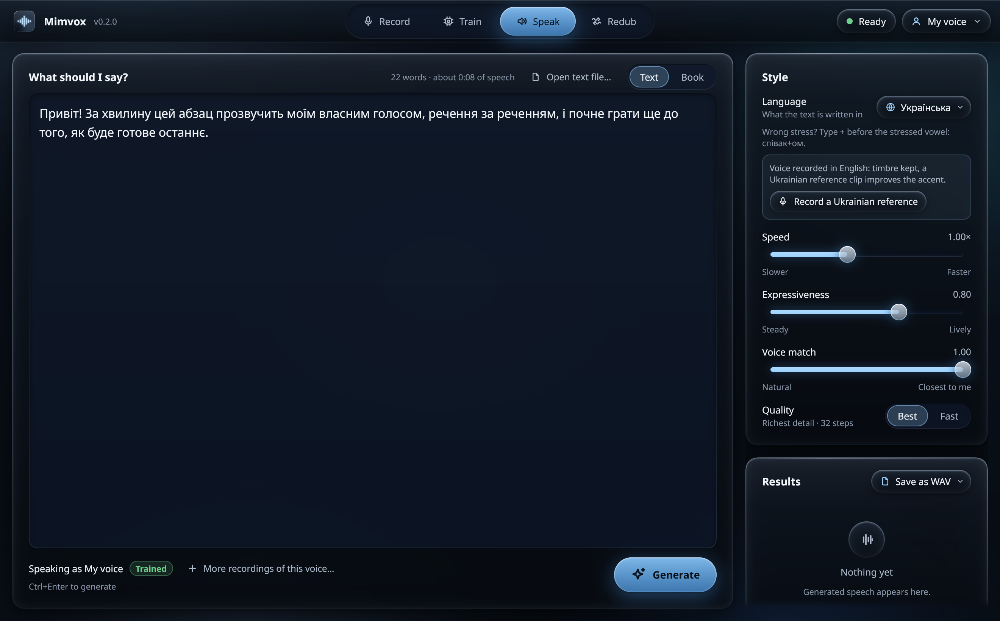

### Generate speech

1. Make sure the voice you want is active (top right). *Speaking as My voice* under the text box confirms it.
2. Type or paste text into **What should I say?**. The counter shows the words and the estimated length of speech.
3. Press **Generate** (or **Ctrl+Enter**).

### The Style panel

| Control | What it does |
| --- | --- |
| **Language** | The language the text is written in. Any of the about 60 languages; the common ones are listed first and you can search. It defaults to the language the voice was recorded in, and the choice is remembered per voice. |
| **Speed** | 0.8x (*Slower*) to 1.3x (*Faster*), default 1.00x. Relative to the pace of the reference clip. |
| **Expressiveness** | *Steady* to *Lively*, default 0.80. Lower is flatter and steadier, higher varies phrasing and pauses more. |
| **Voice match** | *Natural* to *Closest to me*, default 1.00. How strongly the trained timbre model pulls the sound towards your recordings. Applies only to a trained voice. In a language the voice was not recorded in it is capped at 0.3 so the words stay clear. |
| **Quality** | **Best** (32 steps per sentence, the richest detail) or **Fast** (16 steps, about twice as fast, slightly less clean). With the native accent of an untrained voice it also sets the voice converter's steps (12 or 8). |

The defaults are the validated settings; you do not need to change them.

### Word stress (Ukrainian)

The speech model guesses where the stress goes in each word. In Ukrainian it sometimes guesses wrong, most often on
words stressed on the last syllable (for example *співаком* read as співАком instead of співакОм). You can tell it:

- Type **+** before the stressed vowel: `співак+ом`, `з+амок` (зАмок, a castle), `зам+ок` (замОк, a lock).
- Or write the stressed vowel in capitals inside the word: `співакОм`. An acute accent after the vowel (`співако́м`,
  `співако´м`) is accepted too.

The mark is not read aloud: Mimvox turns it into a capital vowel, the hint the model follows best. The Speak
screen shows this as a one-line hint when the language is Ukrainian. Marks work the same way in Russian and Belarusian
text; in other languages they are removed.

A mark is a strong hint, not a guarantee: the model was not trained on stress-marked text and follows the mark most
of the time, not always. If a word stays wrong, generate the phrase again. Mark only the words that come out wrong:
the model gets most words right by itself, and marking every word did not make whole sentences better.

### Streaming playback

Long text is split into segments: the first sentence alone, then growing groups of sentences. Each segment is played
as soon as it is ready while the rest is still being made, so you hear the first words after a few seconds. On slower
hardware the app holds the first segment back a little (*Getting ahead · part k of n*) so playback never stutters.

The playback shows in the [player bar](#the-player-bar), where you can pause it or change its speed while it plays.

The very first phrase after the app starts is slower, because the voice has to be prepared (*Preparing voice…*). Later
phrases are much faster: leave the app open and the models stay loaded.

### Results and export

Each finished phrase appears under **Results** with its length and how long it took to make. For each one:

- the **play** button plays it in the [player bar](#the-player-bar) (press it again to pause);
- **Export as…** saves a copy in another format (see below);
- the folder button shows the file in your file manager, and the other button opens it in your default player;
- the **trash** button deletes the result. It asks first (*Delete this result?* **Delete** / **Cancel**); **Delete**
  stops it if it is playing, removes the saved file from `outputs` (and its temporary playback copy) and takes it off
  the list. This cannot be undone. If the file cannot be deleted (for example it is open in another program), a
  message says so and the result stays in the list.

Every result is also saved automatically as one file in the `outputs` folder of your data folder
(`outputs/<date>_<time>.wav`), with a small `<date>_<time>.result.json` next to it that remembers the text, the voice
and the settings. So the Results list survives a restart: when the app starts it shows your latest 50 results, newest
first, and **Show older** at the bottom of the list loads more. Results saved by an older version of the app (without
that file) appear with their file name as the title and without "made in". After a restart a result saved as MP3 (or
any format other than WAV) takes a moment to start the first time you play it: the app makes a playback copy first.

**Save as** (the chip next to the Results title, "Save as WAV" at first) chooses the format of that file: WAV, MP3,
FLAC, OGG, Opus, M4A or AIFF, each with a one-line description. The choice is remembered and shared with Redub, and
applies to the next result. WAV is the default and the best for editing; MP3, Opus or M4A make much smaller files
(saved at high quality, for example MP3 at 320 kbps). Playback in the app always works, whatever the format: for a
format other than WAV the app plays a temporary WAV copy that is removed when the app restarts. The folder button,
**Open file** and **Export as…** use the saved file.

**Export as…** offers WAV, MP3, FLAC, OGG, Opus, M4A and AIFF, with a quality of **High**, **Standard** or **Small**
for the lossy formats (for example MP3 at 320, 192 or 128 kbps). Your last choice is remembered.

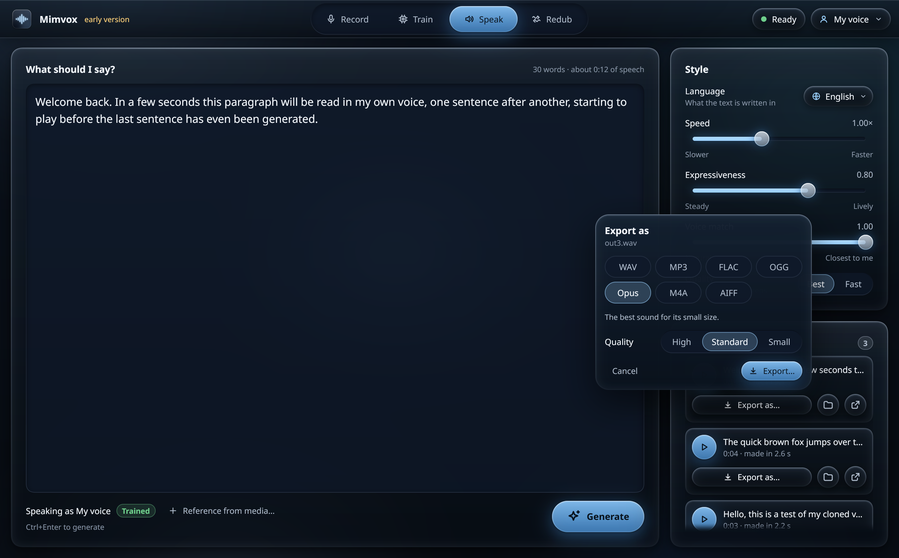

### Example: a Ukrainian paragraph with a voice recorded in English

1. Pick your English voice (for example "My voice", recorded with the English Standard preset).
2. Open **Speak** and set **Language** to **Ukrainian**. A hint appears: *"Voice recorded in English: timbre kept, a
   Ukrainian reference clip improves the accent."*
3. Paste the text:

   > Сьогодні вранці я вийшов на прогулянку вздовж річки. Повітря було свіже, а небо ясне, і я подумав, що це
   > слушний момент записати свій голос.

4. Press **Generate**. Numbers, dates and abbreviations are spelled out in Ukrainian before speaking (for example
   `у 2026 році` is read as "у дві тисячі двадцять шостому році").
5. The result keeps your timbre but has a slight English accent. To remove it, press **Record a Ukrainian reference**
   in the hint. It opens the Voices screen with the per-language panel ready: read the sample text for about 10
   seconds, press **Use for Ukrainian**, come back and generate again.

### Native accent: English with an American accent

The speech model copies the accent of the clip it clones, so English spoken from a clip of Ukrainian speech has a
Ukrainian accent. What counts is the language actually spoken in the clip (shown in Voices, see above), not the
language the voice was created with. For English, any voice can instead speak with a native American accent: a native
US English speaker (shipped with the app, from the public CMU ARCTIC corpus) says the text, and a voice converter then
gives it your timbre.

**Zero-shot or trained.** A voice you have only recorded is *zero-shot*: the converter is a zero-shot voice converter
(Seed-VC, installed by setup) that takes your timbre straight from your reference clip, with no training. A *trained*
voice uses its own voice model instead, moved to your own pitch: that is closer to you, so training still pays off.
Without the zero-shot converter (an install that left it out with `--no-zero-shot-vc`, or from before it existed: run
setup again) only trained voices get the native accent.

**Accent** appears in the Style panel when the output language is English and the voice has no English clip: no
English clip under Other languages, and its main clip is in another language (or, while that is not checked yet, the
voice was created with another language):

- **Native (American)** (the default): a native speaker says it, your timbre is kept. The caption says how: *Native
  accent from your reference clip (no training needed)*. It goes through the zero-shot converter for trained voices
  too, which sounds cleaner than a voice model trained on a few minutes; only without the converter does a trained
  voice use its model (*your trained voice model keeps your timbre*). With it, **Speaker** picks the native speaker: **Auto** (the one whose
  pitch is closest to yours), **Male** or **Female**.
- **Like my recordings**: your own reference clip speaks, with its accent. The caption names it (*English gets the
  accent of your Ukrainian reference clip*), and **Add an English clip** is right below.

When the zero-shot converter is missing, an untrained voice shows the choice but off, with *Run setup to install the
zero-shot voice converter, or train this voice, ...* and the **Add an English clip** button. Native stays the default
until you change it; then your choice is remembered and also applies to **Translate & dub** into English and to
**Re-speak** when the transcript is English (see Redub).

When a result is spoken from a clip in another language than the text anyway, a warning says so, for example *The
reference clip is Ukrainian speech, so the English carries a Ukrainian accent.*

Example: a Ukrainian voice speaking English with an American accent, no training.

1. Pick a voice recorded in Ukrainian (the header badge may read *Zero-shot*: a reference clip is enough).
2. Open **Speak**, set **Language** to **English** and leave **Accent** on **Native (American)**.
3. Paste: *The weather was clear this morning, so we walked along the river and talked about our plans for the
   summer.*
4. Press **Generate**. The words come out with native American vowels and rhythm, in your timbre. Switch to **Like my
   recordings** and generate again to hear the difference.

The native speaker's delivery (calm, read speech) replaces the manner of your own clip. With a trained voice, Voice
match is kept low (at most 0.2) so your recordings do not pull the vowels back to your accent; for an untrained voice
Voice match does not apply. The first native result of a session takes about 10 s longer while the converter loads
(selecting the voice prepares it in the background).

### Open a text file

**Open text file…** at the top of the text box (or dropping a file on the window, from any screen) reads a document:
TXT in any encoding, Markdown, HTML, EPUB, DOCX, ODT, RTF, FB2, PDF (with a text layer) or subtitles (SRT, VTT). A
short text, up to about 5,000 words, lands in the text box, ready for **Generate**. A longer one opens in **Book**
mode (below). The language of the text is detected and set in the Style panel.

A scanned PDF (pictures of pages, no text layer) cannot be read: run it through OCR first, or use another format of
the book.

### Book mode: an audiobook in your voice

The **Text / Book** switch at the top right of the text box turns Speak into an audiobook maker. It reads a whole
book in the active voice with the Style settings, one file per chapter, and you can pause it and continue later, even
after closing the app.

1. Press **Open book…** (or drop the file on the window). The book opens with the chapters Mimvox found: from the
   EPUB's table of contents, the headings of a DOCX, ODT, FB2, Markdown or HTML file, the PDF's bookmarks, or lines
   such as *Chapter 1*, *CHAPTER IV*, *Розділ 1* in a text file.
2. Check the list. Untick what you do not want read (a table of contents, notes). Click a title to rename it.
   The split button cuts a chapter in two at the paragraph nearest its middle; the join button joins the next chapter
   into this one. The badges show the chapters, words, about how long the audio will be and how long it takes to make.
3. Set the voice, language and Style as for Speak. **Expressiveness** has its own value in Book mode, **0.60** by
   default: a steadier narrator for long listening. In the **Output** panel pick the format ("Save as"), and tick
   **Also make one M4B audiobook with chapter marks** if you want a single file for an audiobook player. **Read each
   chapter's title first** reads the title, then pauses, before the text.
4. Press **Read the book**. The panel shows *Chapter k of n*, the percentage, how much audio is made, about how long is
   left and the speed (for example *1.10× real time*: 10 % slower than listening). Finished chapters get a play button
   (the [player bar](#the-player-bar)); the one being read shows *part i of n*.
5. **Pause** stops at once and frees the GPU (Speak, Redub and training wait while a book is read); **Resume**
   continues from the sentence where it stopped. **Cancel** stops and drops the unfinished chapter (finished chapters
   stay; Resume starts that chapter again). **Open folder** shows the files.

If the app closes while a book is being read, the book is shown again the next time, marked *Interrupted*: press
**Resume**. The **Your books** list on the right keeps every book; click one to open it, or the trash button to remove
it from the list (its audio files stay).

How it sounds: Mimvox reads whole sentences (a sentence is cut only when it is very long, and then only at a comma,
semicolon, colon or dash), keeps the punctuation the model uses for intonation, and inserts pauses that follow it:
short after a comma cut, longer after a sentence, longer still after "…" and between paragraphs, and about a second
after a chapter title. A segment that comes out much louder, higher or faster than the ones around it is made again
once, and every chapter is levelled to the same loudness (-18 LUFS), so you do not have to touch the volume between
chapters.

**Time and space.** On an RTX 4070 an untrained voice with Best quality made a book about three to five times faster
than it lasts (a real-time factor of 0.16-0.37 per chapter: 3.5 minutes of audio in 42 seconds); a trained voice or the
native accent adds a voice conversion per segment and is slower. The estimate before the start assumes 0.5 and is
replaced by the measured pace once the book runs. A 350,000-token novel is roughly 28-30 hours of audio: about 5-15
hours of generation, paused whenever you need the computer. As MP3 that is about 2.5 GB (192 kbps); as WAV about 9 GB.

#### Example: an EPUB to MP3 chapters

1. Speak, switch to **Book**, **Open book…**, choose `Meditations.epub`. Three chapters appear, *English (detected)*.
2. In **Output**, "Save as" **MP3**, tick the M4B box.
3. **Read the book**. When it finishes:

```
<data>/outputs/books/Meditations (excerpts)/
  01 - Chapter 1. Time Is Running Out.mp3
  02 - Chapter 2. Do Every Act As Your Last.mp3
  03 - Chapter 3. Get Up In The Morning.mp3
  Meditations (excerpts).m4b
```

---

## 7. Redub

Redub takes an existing audio or video file and says it again in your voice. Open **Redub**, then drop a file on the
drop zone (or anywhere on the window) or press **Choose file…**. The file card shows its length and format, with a
button to play the original and **Change…** to pick another one.

There are three modes.

| Mode | What it does | Needs |
| --- | --- | --- |
| **Translate & dub** (default) | Transcribes the speech, translates it to the language you choose and speaks it in your voice, each sentence at its original time. | Any voice, trained or not. |
| **Convert voice** | Keeps the original recording, its timing and delivery, and swaps in your trained voice. | A trained voice. |
| **Re-speak** | Transcribes the speech, lets you edit (or translate) the words, then speaks them again in your voice. | Any voice. |

The Style panel on the right (Speed, Expressiveness, Voice match, Quality) is the same as on Speak. Speed and
Expressiveness do not apply to Convert voice, which keeps the original pace.

### Example: a Ukrainian video to English in a couple of clicks

1. Open **Redub** and drop `interview.mp4` (a video of you speaking Ukrainian).
2. Keep **Translate & dub**. Set **From** to **Auto-detect** (or Ukrainian) and **To** to **English** (the default).
3. Press **Translate & dub**.

The job reads the audio, loads the speech models (the first time takes longer), transcribes, translates, speaks each
sentence and saves the result. You can use other tabs meanwhile; **Cancel** stops it. As a measured example, a
44-second Ukrainian clip took about 41 seconds end to end on an RTX 4070. The result appears under **Results** with
**Original** and **Result** buttons so you can compare them.

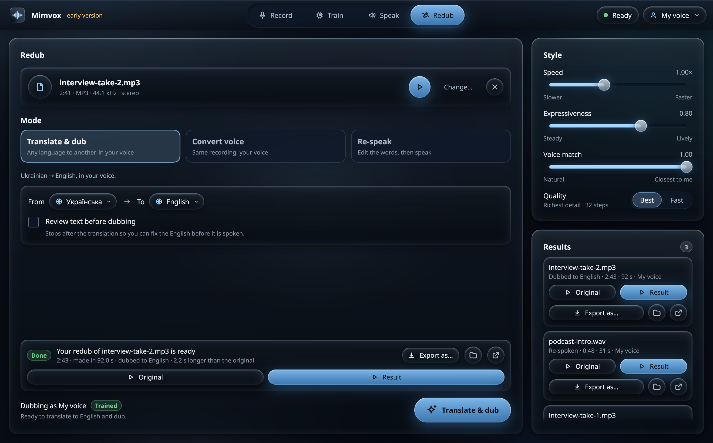

**Translation quality.** When setup installed both translation models (the default with an NVIDIA GPU), the options
show **Translation quality**: **Better (1.3B)** (the default) is the larger, generally more accurate model, and
**Faster (600M)** translates about 1.5 times faster with half the GPU memory. The choice is remembered. Without a GPU only the 600M is installed and the
choice is hidden. Either way, a sentence that Whisper split over several lines is translated as one sentence and the
translation is then shared out over those lines, so each line keeps its own time. Ukrainian gaming slang such as
"перс" or "спавнюється" and spoken times such as "чверть на десяту" (9:15) are rewritten before translating, because
both models got them wrong. Other slang can still come out wrong: use **Review text before dubbing** to fix it.

### Keep original timing

Translate & dub and Re-speak both have **Keep original timing**:

- **On** (the default for a video): *fits each phrase into the original timing; may speed up speech.* A longer
  sentence first uses the pause after it, at your pace; if that is not enough, it is spoken a bit faster, but never
  shorter than 85 % of its natural length (beyond that the speech model starts to swallow short words and the ends of
  phrases; a higher Speed still applies), then sped up slightly by ffmpeg (at most 1.15x, which keeps every sound); if it still does not fit,
  later sentences move a little. Use it for a video: it keeps the new speech in sync with the picture. When the
  output is a video (see [Dub a video and keep its music](#dub-a-video-and-keep-its-music)), it is always on: the box
  is ticked and locked.
- **Off** (the default for an audio file): *natural pace; the result can be longer.* Every sentence is spoken at your
  pace with nothing squeezed. It starts at its original time when the previous one has finished; otherwise right after
  it, with the original pause between them (up to half a second). The result card says how much longer the result is.

The choice is remembered separately for video and audio files once you change it. **Speed** in the Style panel is
your pace in both cases: at 1.3x the speech is that fast on its own, and fitting the timing does not squeeze it
further. Speech is never cut off and sentences never overlap.

### Dub a video and keep its music

When the file is a video, every mode shows two more choices:

- **Output: Video with new voice / Audio only.** *Video with new voice* (the default for a video, remembered) saves a
  copy of the video with your voice; the picture is copied as it is, not re-encoded, so it keeps its full quality
  and takes only a second or two to write, even for 4K. The audio is saved too, as usual, in the **Save as** format.
  *Audio only* saves just the audio, as before.
- **Keep background music and sounds** (on by default, remembered). Redub splits the original sound into the voice
  and the background (music and sound effects) with the music-removal model, puts your voice over the background at
  the loudness of the original voice, and avoids clipping. If the original turned the music down under the speech,
  the music is also turned down where your voice runs past the original speech; otherwise the background is left as
  it is. Off: your voice alone, on silence.

A video result always keeps the original timing (a natural pace would drift away from the picture and from the
music), so **Keep original timing** is ticked and locked while *Video with new voice* is chosen.

Example: a Ukrainian video into English, keeping the music.

1. Open **Redub** and drop `walkthrough.mp4` (you talking Ukrainian over game music). The app splits it into voice
   and music right away, in the background, while you choose the options; on a GPU this takes about 2 seconds for
   2 minutes of video.
2. Keep **Translate & dub**, **From** Auto-detect (or Ukrainian), **To** English.
3. Keep **Output: Video with new voice** and **Keep background music and sounds** ticked.
4. Press **Translate & dub**. After the speaking, the progress shows *Mixing your voice with the background* and
   *Writing the video*.
5. The Done card has **Open video** (it opens in your system's video player), **Result** to hear the audio in the
   app, **Original** to compare, and **Show in folder**. The result is `outputs/redub_<date>_<time>.mp4`, next to the
   audio file of the same name. In **Results** the row has a **Video** badge.

The video keeps its container (MP4, MOV, MKV, WebM, AVI), its subtitles, chapters and metadata; its sound track is
replaced by the new one (AAC for MP4 and MOV, Opus for MKV and WebM, tagged with the spoken language).

**How well it separates.** Measured on a 2-minute 4K MP4 with an English voice over quiet music: the voice left in
the background was about 49 dB under the original voice, which is inaudible under the new voice; separating took
2 seconds on an RTX 4070 (about 11 seconds per 45 seconds of audio on the CPU), mixing 0.6 s and writing the video
1.7 s. Separating the voice did not help the transcription (Whisper made no fewer mistakes on the voice alone, even
with the music 10 dB louder than the voice), so Redub transcribes the original sound.

**What is lost.** Everything the model counts as voice goes with the original speaker: laughs, shouts, singing and
other people's voices are not kept, only music and sound effects. Loud effects that sound like speech can lose a
little too. Without the music-removal model (setup installs it) the video has your voice only, and a notice says why.

**Convert voice** of a video uses the separation too: your trained voice model runs over the separated voice only,
so the music is no longer garbled by it, and the background is mixed back in.

### The same, with "Review text before dubbing"

Machine translation is not perfect, and names are easy to get wrong. To check the text first:

1. Tick **Review text before dubbing** before you start, then press **Translate & dub**.
2. The job stops after the translation and shows a **Review** table: the original on the left, the English on the
   right, with the time of each line.
3. Fix any line on the right. Empty lines are skipped; the trash button removes a line.
4. Press **Dub it**. Only now is the text spoken in your voice. **Discard review** drops it.

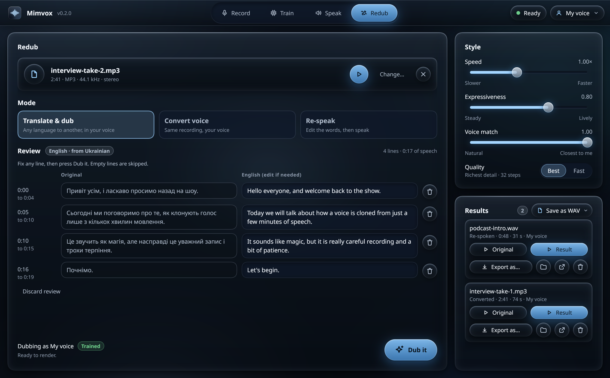

### Convert voice

1. Choose a file and select **Convert voice**.
2. Press **Render**.

Your trained timbre model runs over the whole file, so the result has exactly the original length and timing. For
an audio file, music and background noise are converted along with the voice (they are not separated), so this works
best on a clean recording of speech; for a video, the voice is separated first and the music is kept (see
[Dub a video and keep its music](#dub-a-video-and-keep-its-music)). With an untrained voice the mode offers
**Go to Train** or **Use Translate & dub** instead.

### Re-speak

1. Choose a file and select **Re-speak**.
2. Set **Spoken language** (or Auto-detect). Tick **Translate the transcript** and pick **To** if you want it in
   another language.
3. Press **Transcribe**. The transcript appears as editable lines with their times.
4. Fix the words, delete lines you do not want, then press **Render**. Transcribing again replaces your edits.

**Keep original timing** works as in Translate & dub (see [Keep original timing](#keep-original-timing)): on, each
line is fitted into its original time; off, the lines are spoken at your natural pace one after the other.

When the text is English (spoken or translated) and the voice has no English clip, the options show the same
**Accent** choice as Speak (see [Native accent](#native-accent-english-with-an-american-accent)), and the render uses
it.

### Supported formats and exporting

- **Input:** WAV, MP3, M4A, AAC, FLAC, OGG, Opus, AIFF, WMA (when your ffmpeg can decode it), and the video formats
  MP4, MKV, MOV, WebM and AVI. From a video, the first audio track is used.
- **Output:** 44.1 kHz audio (mono, or stereo with a kept stereo background), saved automatically as one file,
  `outputs/redub_<date>_<time>.wav`, or in the format chosen with **Save as** in the Results header (shared with
  Speak, see [Results and export](#results-and-export)). For a video with **Output: Video with new voice**, also
  `outputs/redub_<date>_<time>.mp4` (or the source's container) next to it.
- **Export as…** on a result converts its audio to WAV, MP3, FLAC, OGG, Opus, M4A or AIFF, as on Speak. For the video
  use **Show in folder** and copy the file.
- The **trash** button on a result in the Results list deletes it, after asking, exactly as on Speak: the saved file
  in `outputs` and its playback copy are removed and the row leaves the list. The original file you dropped is never
  touched.
- **Original** and **Result** play in the [player bar](#the-player-bar); press one again to pause it.
- The Results list survives a restart, as on Speak: your latest 50 redubs, **Show older** for more. **Original** plays
  only for redubs made since the app started (the original file is not kept). A redub saved by an older version of
  the app shows its file name and "Redubbed".

Redub uses the GPU like Speak: only one job runs at a time, and Redub is unavailable while a voice trains.

---

## 8. Tips for quality

- **A clean reference.** The speech model copies whatever is in the reference clip: noise, echo, a tired voice, a slow
  pace. Listen to it on the Voices screen and use **Choose…** to switch to a relaxed, natural-sounding clip.
- **No music, no noise.** Record in a quiet, soft room. For media files and Redub sources, prefer clips with speech
  only: background music and other voices end up in the clone or the conversion. For media references, **Remove
  background music** takes out most music; other voices stay.
- **A consistent microphone.** Use the same microphone, distance (15-20 cm) and room for every part, and for parts
  you add later. Turn off noise suppression and automatic gain in your system if you can.
- **Reference length.** The automatic reference is a 15-20 second window, and the speech model uses up to 12 seconds
  of it; media references are 8-12 seconds; per-language clips need 3-40 seconds, about 10 is best. Longer is not
  better here: clean and natural is what counts.
- **Accent across languages.** The voice keeps the accent of its reference clip, in whatever language that clip is
  spoken (Voices shows it). For the most natural result in another language, add a per-language reference clip in
  that language; for English, any voice can also use the native accent. For trained voices, Voice match is
  capped at 0.3 in other languages so the words stay clear.
- **Quality beats quantity.** Six clean minutes are better than twenty noisy ones. Re-record a part as soon as the check
  says *Please record again*, not after training.

More detail: the [recording guide](recording-guide.md).

---

## 9. Troubleshooting

| Problem | What to do |
| --- | --- |
| **"The voice engine stopped"** (banner under the header, the pill says *Engine stopped*) | Press **Retry** in the banner, or press the pill. The banner shows the last error line. If it keeps stopping, look at the engine log (below) and run `./setup.sh --quick-check` (or `setup.cmd --quick-check`) to verify the install. A *"not set up yet"* message means setup has not completed: run it again. |
| **Generation is slow** | The first phrase after start is always slower (the models and the voice are being prepared). Check the device on the welcome screen or by hovering the *Ready* pill: it should name your NVIDIA GPU. If setup reported the `cpu` backend, re-run setup on a machine with a supported GPU and current NVIDIA driver. Close other programs that use the GPU (games, other AI tools, browsers with hardware acceleration). **Fast** quality is about twice as fast per sentence. Do not train while you want to speak. |
| **"CUDA out of memory"** | Close other programs that use the GPU. 8 GB of video memory is the practical minimum. If it persists, restart the app so the engine reloads cleanly. |
| **The microphone is missing** | Open the microphone chip on Record: the list is refreshed every time it opens. Plug the microphone in before opening it, check that it is enabled and not muted in your system's sound settings, and that the app is allowed to use the microphone (macOS and Windows privacy settings). *"Cannot use this microphone"* shows the system's reason. A remembered microphone that is gone falls back to the system default with a warning. |
| **"No clear speech found"** on every take | The wrong input is selected, or it is muted. Use the level test in the microphone list: the bar must move when you speak. |
| **A file is refused** | *"That kind of file is not supported"*: use one of the formats listed in [Redub](#supported-formats-and-exporting). A video without sound gives *"This file has no audio track."* |
| **Redub says the translation model is not installed** | Run setup again; it downloads the missing Redub models. |

### Where the logs are

All paths are relative to your data folder (see [the table above](#first-launch-setup-in-the-app)):

| File | What is in it |
| --- | --- |
| `logs/engine.log` | Everything the engine writes while it runs (model loading, errors). It is started fresh every time the engine starts, so copy it **before** you press Retry or restart the app if you want to keep it. |
| `tmp/train_<voice id>.log` | The full output of the last training of that voice. The `tmp` folder is emptied at every engine start. |

Setup prints its progress to the terminal it runs in; there is no separate setup log.

---

## 10. Your data folder

Everything the app makes lives in one folder (the one you chose during setup; see the defaults in
[Install](#first-launch-setup-in-the-app)). The **Data location** card at the bottom of the Voices screen shows its path.

```
<data folder>/
  voices/
    my-voice/                    one folder per voice (the id is made from the name)
      voice.json                 name, language, training state
      reference.wav              the reference clip
      reference_uk.wav           optional per-language reference clips
      reference_media.wav        optional combined media for "Reference from media"
      dataset/part1.wav ...      your recorded parts
      rvc/model.pth, model.index the trained voice model (after training)
  outputs/                       every generated phrase and redub, one file each (WAV unless "Save as" says otherwise),
                                 each with a <name>.result.json that lets the Results lists come back after a restart
  logs/engine.log                the engine log
  tmp/                           scratch files, emptied at every engine start (tmp/setup: setup's own)
  cache/uv/                      the Python package cache setup installs from (safe to delete; a move leaves it behind)
  settings.json                  your app settings (microphone, last choices, "Save as" format, "Remove background music")
  runtime/, runtime.toml         the installed engine and models (about 30 GB)
```

The id of a voice folder is made from its name: lower case, with letters of other scripts transliterated (for example
"My voice" becomes `my-voice`). Renaming a voice in the app does not rename its folder.

### Back up a voice

1. Close the app (so nothing is being written).
2. Copy the voice's folder, for example `voices/my-voice/`, somewhere safe. It holds the recordings, the reference
   clips and the trained model.

To restore it, close the app and copy the folder back into `voices/`. It shows up in the list on the next start. A
paused training is not part of this backup (its checkpoints live in the runtime folder); finish or discard it first.

Your generated speech is in `outputs/`; copy that folder too if you want to keep it.

### Delete a voice

On the Voices screen press **Delete** on the voice's card and confirm. This deletes the voice's folder for good. You can
also delete the folder by hand while the app is closed. To remove everything the app made, delete the whole data
folder (and `location.toml`, if setup created one for a custom location).

---

## 11. Consent and licences

- **Clone only your own voice, or the voice of a person who has given you explicit permission** (ideally in writing). Never
  use recordings of someone else taken from calls, videos or podcasts. This applies to recording, importing files,
  reference from media and Redub alike.
- **Do not use generated speech to deceive anyone**, and say that it is synthetic where the law or common decency
  expects it.
- **Non-commercial use only.** The OmniVoice speech model weights and the NLLB-200 translation model are licensed
  CC BY-NC 4.0.

The full terms are in [DISCLAIMER.md](../DISCLAIMER.md), and the licences of every component in
[THIRD_PARTY_NOTICES.md](../THIRD_PARTY_NOTICES.md).
